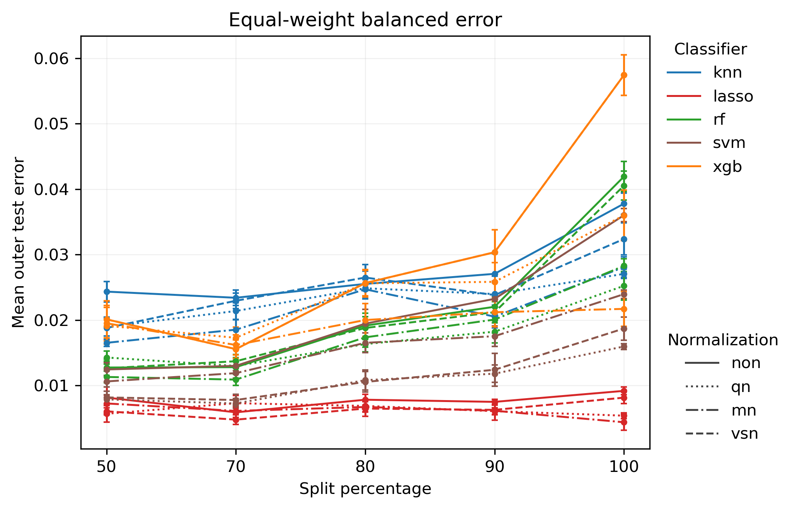
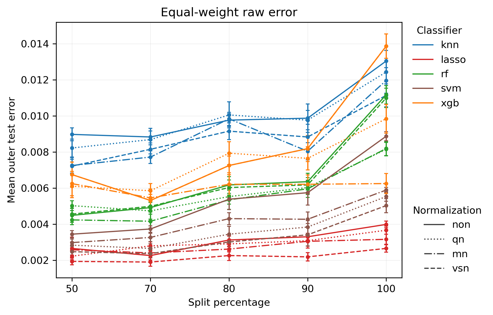
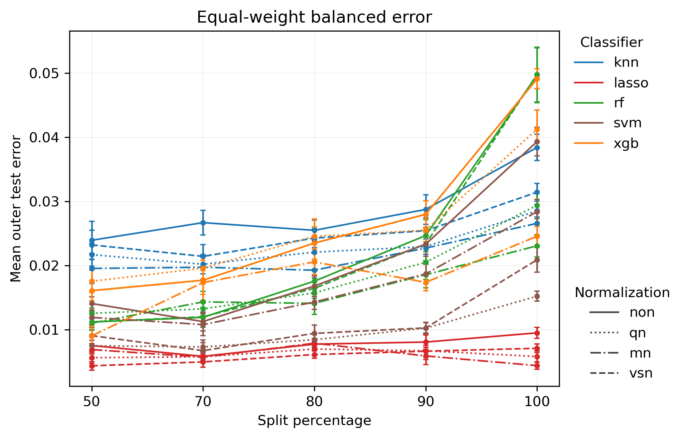
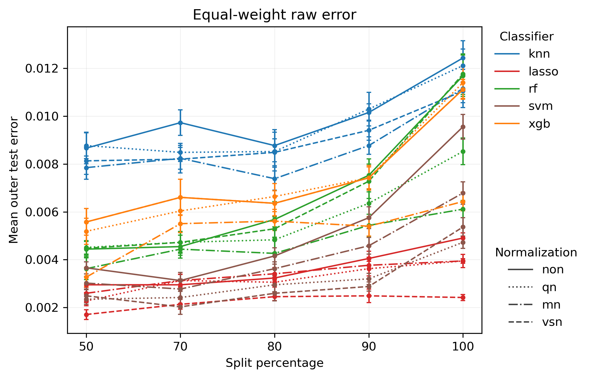
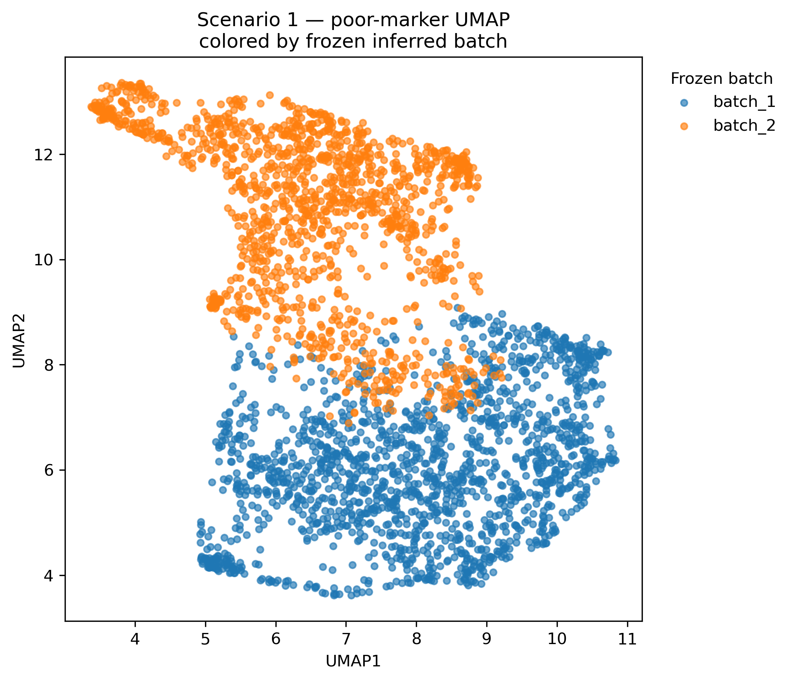
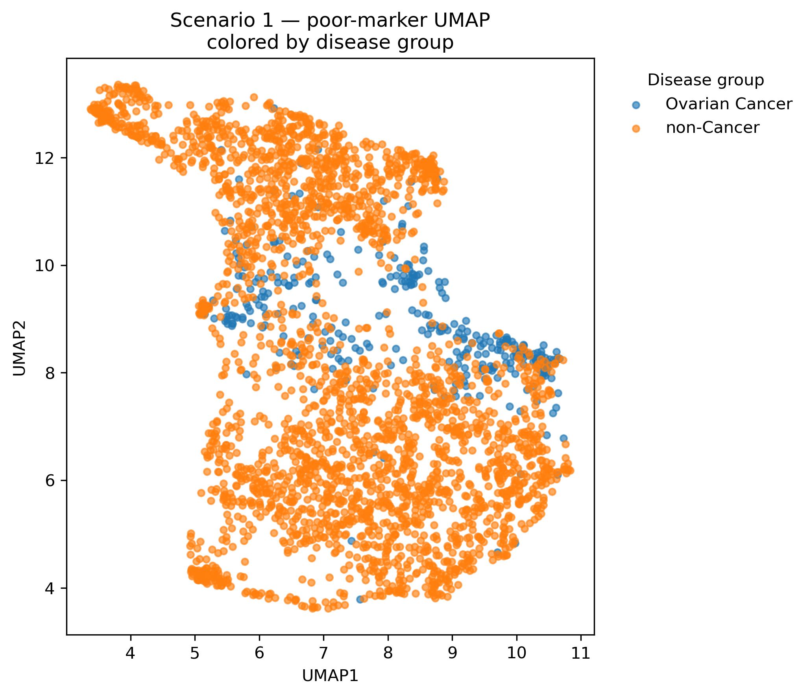
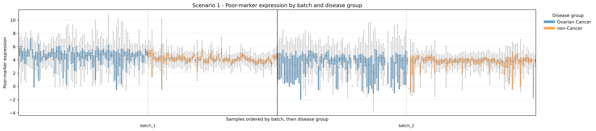

# Yokoi S1 — Dual-Track Validation Result Interpretation

## Research purpose

This Pro analysis separates the original single SSV evaluation into two complementary tracks:

- **Natural protocol = primary real-world analysis**: preserves the original class prevalence in each batch and is intended to reflect the total difficulty of cross-batch deployment under the observed data distribution.
- **Class-stratified protocol = sensitivity / mechanism analysis**: approximately matches class composition across batches so that the influence of class-prevalence differences is reduced, allowing the remaining degradation to be interpreted more directly as batch/domain shift.

The purpose of this design is to separate different sources of distribution shift rather than mix them into one summary curve.

## S1 results

### 1. Class-stratified protocol

*Figure 1. S1 — Class-stratified protocol: equal-weight balanced error.*

*Figure 2. S1 — Class-stratified protocol: equal-weight raw error.*

Under the class-stratified protocol, the class composition of the two batches is made more comparable, so the remaining change in performance is more closely related to batch/domain shift itself. For S1, most classifier–normalization combinations show higher error at split 100 than at split 50 in both raw error and balanced error.

This means that the degradation under strict cross-batch validation does not disappear after controlling class prevalence. Therefore, the S1 pattern cannot be explained by class-prevalence imbalance alone; a batch/domain effect remains visible.

### 2. Natural protocol

*Figure 3. S1 — Natural protocol: equal-weight balanced error.*

*Figure 4. S1 — Natural protocol: equal-weight raw error.*

The Natural protocol keeps the original class prevalence of each batch and is therefore closer to the actual deployment setting. In S1, most methods again show higher error at split 100 than at split 50, indicating that generalization becomes more difficult when the training and test sets are increasingly separated by batch.

This track reflects the total cross-batch difficulty under the observed data distribution, including both batch/domain shift and any associated class-prevalence shift.

### 3. Raw error vs balanced error

Across the four plots, balanced error is generally higher than raw error. This difference is useful because raw error is strongly influenced by the majority class, whereas balanced error gives the two classes equal weight.

When raw error remains very low but balanced error is noticeably higher, the overall accuracy is partly driven by the easier or more prevalent class. In this setting, balanced error helps reveal class-specific performance imbalance that raw error alone can hide.

## Overall interpretation

The Natural and Class-stratified analyses lead to the same qualitative conclusion for S1: stricter batch separation, especially the split = 100 setting, is generally associated with worse predictive performance.

The important point is that this degradation remains visible after class prevalence is controlled. Therefore, class-prevalence shift may contribute to the observed performance change, but it does not fully explain it. The remaining degradation is consistent with a genuine batch/domain effect.

This is exactly what the dual-track design is intended to distinguish:

- **Natural** asks how much performance is lost under the observed, real-world batch composition.
- **Class-stratified** asks how much of that degradation remains after reducing class-prevalence differences.

For S1, both tracks point in the same direction, which strengthens the interpretation that strict cross-batch validation is genuinely more difficult rather than being an artifact of class imbalance alone.

## Concise conclusion

For Yokoi S1, most models have higher error at split 100 than at split 50 under both Natural and Class-stratified protocols. The same pattern is also visible in balanced error. Because the degradation persists after class-prevalence balancing, the result is more consistent with a genuine batch/domain effect than with a pure class-imbalance artifact. The dual-track analysis therefore separates real-world degradation from mechanism-level attribution more clearly than a single SSV evaluation.\n\n## Batch-structure QC\n\nThe following QC plots use the poor-marker expression space to examine whether the frozen inferred batches correspond to a visible expression structure, and whether that structure simply reproduces the disease labels.\n\n### 4. UMAP colored by frozen inferred batch\n\n\n\n*Figure 5. S1 — Poor-marker UMAP colored by frozen inferred batch.*\n\nThe frozen batch labels show a clear large-scale separation in the poor-marker UMAP space. Batch 1 is concentrated mainly in the lower part of the embedding, while Batch 2 occupies much of the upper region, with an intermediate overlap zone between them. This provides visual support that the poor-marker feature space contains a substantial batch-associated structure.\n\nThe important point is that this UMAP is used only as a visualization of the already frozen batch labels. It does not redefine the batches or rerun the original UMAP/KMeans batch inference.\n\n### 5. UMAP colored by disease group\n\n\n\n*Figure 6. S1 — Poor-marker UMAP colored by disease group.*\n\nWhen the same embedding is colored by disease group, ovarian-cancer samples are concentrated more strongly in the central region, but they do not form a completely separate cluster. There is substantial overlap with non-cancer samples, while the non-cancer group also occupies large regions outside the main ovarian-cancer concentration.\n\nThis pattern is different from the batch-colored UMAP. The batch separation is visually clearer than the disease separation, suggesting that the frozen inferred batches are not simply reproducing the ovarian-cancer versus non-cancer label. At the same time, the partial overlap between batch structure and disease-group structure means that technical/domain variation and biological composition are not completely independent.\n\n### 6. Poor-marker sample-wise boxplot\n\n\n\n*Figure 7. S1 — Poor-marker expression distributions by frozen batch and disease group.*\n\nThe sample-wise boxplot gives a complementary view of the same structure. Within both batches, ovarian-cancer and non-cancer samples show overlapping but non-identical poor-marker distributions, while the overall expression pattern also changes between Batch 1 and Batch 2. This is consistent with the UMAP result: the poor-marker space contains both batch-associated variation and disease-related variation.\n\nThe boxplot should therefore be treated as a QC diagnostic rather than as a direct measure of batch-effect magnitude. Its role is to show that the inferred batch structure is visible at the expression-distribution level and is not fully explained by disease status alone.\n\n### QC interpretation\n\nTaken together, the two UMAP views and the sample-wise boxplot support the use of the frozen inferred batches for the downstream SSV analysis. The poor-marker space contains a strong batch-associated structure, while disease labels show only partial and overlapping separation in the same space. This makes the S1 batch definition more plausible as a domain/batch structure rather than a simple proxy for the biological outcome.\n\nThese QC plots do not replace the quantitative Pro results. The strength of the batch effect is still evaluated through the split-dependent error curves, the Natural versus Class-stratified comparison, and the direction-aware analysis.\n
