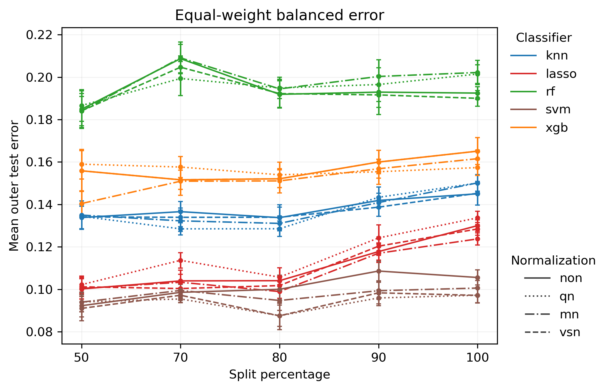
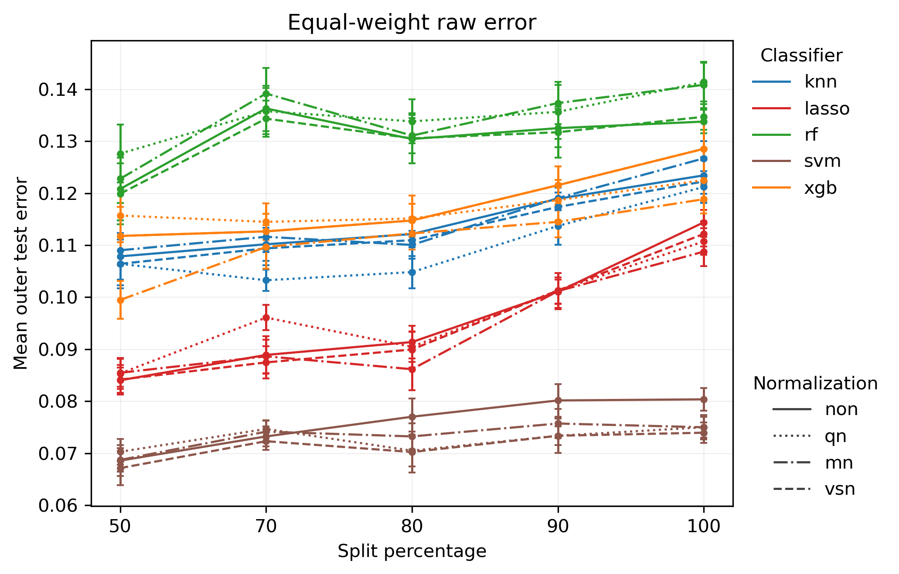
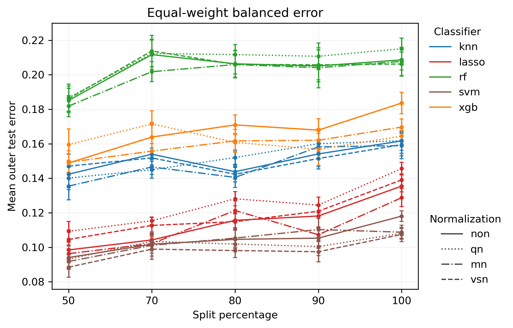
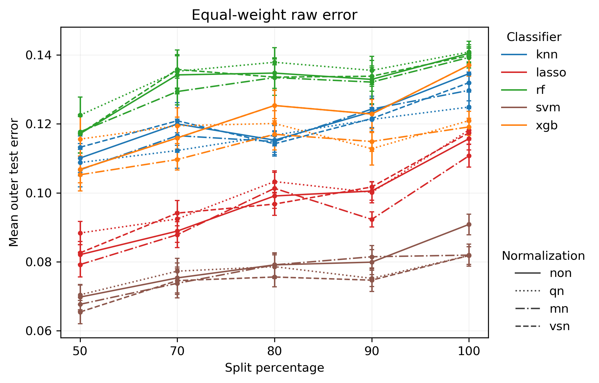
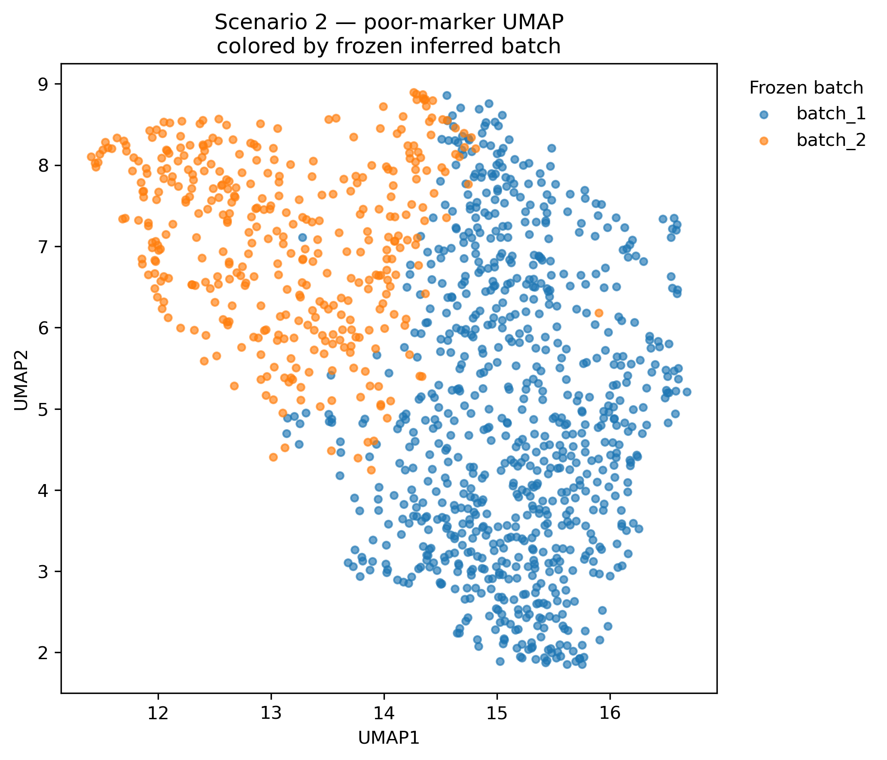
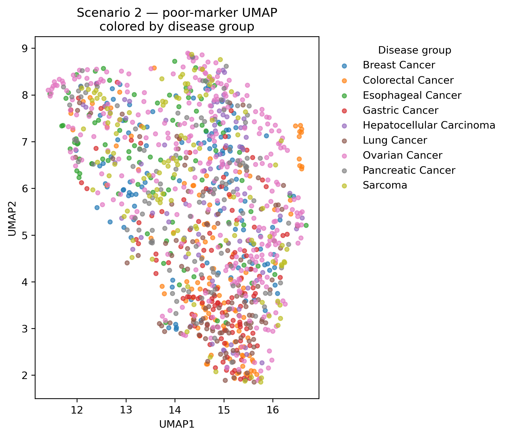
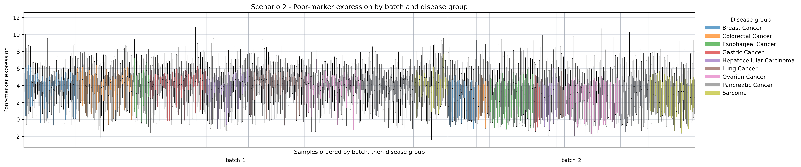

# Yokoi S2 — Dual-Track Validation Result Interpretation

## Scenario context

The Yokoi analysis contains three different medical classification settings:

- **S1: Ovarian cancer vs non-cancer.** This is mainly a cancer-detection problem: the model separates ovarian cancer from non-cancer samples.
- **S2: Ovarian cancer vs other cancers.** The negative class contains breast, colorectal, esophageal, gastric, hepatocellular, lung, pancreatic cancer, and sarcoma. This is therefore closer to a **cancer-type discrimination / differential diagnosis** problem rather than a simple cancer-vs-control problem.
- **S3: Ovarian cancer vs benign ovarian disease, borderline ovarian tumor, and non-cancer controls.** This setting asks whether ovarian cancer can be distinguished from clinically related benign/borderline ovarian conditions together with non-cancer controls.

These three scenarios should not be expected to have the same baseline difficulty. In particular, S2 is biologically more demanding than S1 because the comparison group is made up of other malignancies rather than healthy/non-cancer controls. The absolute error level therefore matters when comparing scenarios, not only the trend across split percentages.

## Research purpose

As in S1, the Pro workflow separates the SSV evaluation into two complementary tracks:

- **Natural protocol = primary real-world analysis**: preserves the observed class prevalence in each batch and measures the total difficulty of cross-batch deployment.
- **Class-stratified protocol = sensitivity / mechanism analysis**: makes the class composition of the two batches more comparable, reducing the contribution of class-prevalence shift so that the remaining degradation can be interpreted more directly as batch/domain shift.

The main quantity of interest is not whether every curve is strictly monotone, but whether stricter batch separation, especially the move from split 50 to split 100, produces a consistent increase in error and whether that increase remains after class-prevalence control.

## S2 results

### 1. Class-stratified protocol

*Figure 1. S2 — Class-stratified protocol: equal-weight balanced error.*

*Figure 2. S2 — Class-stratified protocol: equal-weight raw error.*

After class composition is made more comparable across batches, most methods still show higher error at split 100 than at split 50. The increase is not perfectly monotone for every normalization and classifier, but the overall endpoint pattern is clear: strict cross-batch validation is generally harder than the mixed-batch setting.

The balanced-error curves are substantially higher than the raw-error curves. This indicates that the overall misclassification rate still understates some class-specific difficulty. In other words, even after class-stratified sampling, the two outcome classes are not equally easy to recognize.

The class-stratified result therefore supports the same main interpretation as S1: the degradation at stronger batch separation does not disappear once class-prevalence differences are reduced. Batch/domain shift remains an important part of the performance loss.

### 2. Natural protocol

*Figure 3. S2 — Natural protocol: equal-weight balanced error.*

*Figure 4. S2 — Natural protocol: equal-weight raw error.*

The Natural protocol shows the total cross-batch difficulty under the observed data distribution. Again, most classifier-normalization combinations have higher error at split 100 than at split 50.

Compared with the class-stratified arm, the overall pattern remains similar rather than collapsing after class-prevalence control. This suggests that class-prevalence shift is not the sole explanation for S2 degradation. The strict cross-batch setting remains difficult even when the class distribution is adjusted.

The agreement between Natural and Class-stratified results is useful here: it means the conclusion is not tied to only one way of handling the class composition.

## A distinctive feature of S2: classifier-level stratification

A striking feature of S2 is that the curves form clear **classifier-specific bands** across split percentages and normalization methods.

The approximate ordering is stable:

\[
\text{SVM (lowest error)}
\;<\;
\text{LASSO}
\;<\;
\text{KNN / XGB}
\;<\;
\text{RF (highest error)}.
\]

The exact position of KNN and XGB can change with normalization and split, but the broader separation between classifiers is persistent. Curves belonging to the same classifier tend to stay closer to one another than curves from different classifiers.

This pattern suggests that, for S2, **classifier choice contributes more to the absolute performance level than normalization choice alone**. The data are not simply showing one common batch-effect curve shifted slightly by preprocessing. Different learning algorithms respond quite differently to the same ovarian-vs-other-cancer discrimination task.

That is scientifically meaningful because S2 is not a simple cancer-vs-control problem. All samples in the comparison are malignant, so many broad cancer-associated molecular signals may be shared across classes. The classifier must identify signals that are more specific to ovarian cancer rather than signals that merely separate cancer from non-cancer tissue. Under this setting, the inductive bias and decision boundary of the classifier matter much more.

The stable classifier bands also mean that the batch effect should not be summarized without reference to the model. S2 supports two simultaneous conclusions:

1. stricter batch separation generally increases error within a classifier; and
2. the baseline difficulty and sensitivity to that shift differ substantially across classifiers.

So the SSV result here is partly a property of the data-generating shift and partly a property of the learning algorithm used to handle that shift.

## S1 vs S2: difference in medical classification difficulty

The contrast with S1 is already clear.

In **S1**, ovarian cancer is compared with non-cancer samples. The separation is relatively easy: raw error is very low for many classifier-normalization combinations, and even balanced error remains far below the levels seen in S2.

In **S2**, ovarian cancer must be separated from eight other cancer types. The absolute error level rises markedly:

- raw error is roughly on the order of 0.07–0.14 for many settings;
- balanced error is roughly on the order of 0.09–0.22.

This is not simply evidence that S2 has a “worse batch effect.” It first reflects a harder **medical discrimination problem**. Other cancers are biologically closer to ovarian cancer than non-cancer controls, so the classifier has less obvious disease-status signal to exploit.

Therefore, when comparing scenarios, two quantities should be kept separate:

\[
\text{absolute classification difficulty}
\]

and

\[
\text{additional degradation caused by stronger batch separation}.
\]

S2 is harder than S1 in the first sense, while the split-dependent curves are used to evaluate the second.

This distinction will be important when S3 is added: the three scenarios should be compared not only by their \(\Delta_{100-50}\), but also by the clinical composition of the negative class and the resulting baseline classification difficulty.

## Overall interpretation

S2 gives a consistent dual-track result. Under both Natural and Class-stratified protocols, most models perform worse under strict batch separation than under the mixed-batch setting. Because this degradation remains after class-prevalence control, the pattern cannot be attributed only to class-prevalence shift.

At the same time, S2 reveals something that is much less prominent in S1: the classifiers form distinct performance layers. SVM and LASSO remain in lower-error bands, KNN and XGB occupy intermediate bands, and RF is consistently the highest-error group. This indicates that classifier choice is an important source of variation in this cancer-type discrimination setting.

The main interpretation for S2 is therefore two-part:

- **batch/domain shift still matters**, because error generally increases as the train/test batches become more separated;
- **model choice matters strongly**, because different classifiers retain clearly separated error levels across the same splits and normalization procedures.

## Concise conclusion

Yokoi S2 is a substantially harder problem than S1 because it distinguishes ovarian cancer from other malignancies rather than from non-cancer controls. The Natural and Class-stratified analyses both show that strict cross-batch validation generally increases error, so the degradation is not explained by class prevalence alone. In addition, the clear classifier-specific bands show that algorithm choice has a strong effect on performance in this scenario. S2 therefore illustrates that cross-batch robustness depends not only on the magnitude of the distribution shift, but also on the underlying medical discrimination task and the classifier used to model it.

## Batch-structure QC

The S2 QC figures provide a complementary view of the batch structure used in the Pro analysis. These plots are not used to redefine the frozen batches; they are diagnostic visualizations of the poor-marker expression space and the existing frozen batch assignments.

### UMAP colored by frozen inferred batch

*Figure 5. S2 — Poor-marker UMAP colored by frozen inferred batch.*

The frozen-batch UMAP shows a strong large-scale separation between the two batches. Most `batch_2` samples occupy the upper-left part of the embedding, while most `batch_1` samples occupy the lower-right region, with only a limited transition zone between them.

This supports the use of the frozen batch labels in the downstream SSV analysis: the poor-marker expression space contains a clear batch-associated structure rather than an arbitrary partition.

### UMAP colored by disease group

*Figure 6. S2 — Poor-marker UMAP colored by disease group.*

When the same UMAP is colored by cancer type, the disease groups are much more intermixed. Ovarian cancer does not form a clean isolated cluster, and the eight other cancer types also overlap extensively with one another.

The contrast between the two UMAPs is important. The strongest visible structure in the poor-marker space is associated with frozen batch rather than with cancer type. This suggests that the inferred batch assignment is not simply reproducing the disease labels.

This pattern is also consistent with the medical difficulty of S2. Because all groups are malignant, the model must distinguish ovarian cancer from other cancers rather than separate cancer from non-cancer. Shared cancer-related molecular signals can therefore lead to substantial overlap among disease groups.

### Poor-marker sample-wise boxplot

*Figure 7. S2 — Sample-wise poor-marker expression by batch and disease group.*

The sample-wise boxplot gives the same picture at the expression-distribution level. Different cancer types overlap heavily within each batch, while the overall dispersion and expression structure still differ between `batch_1` and `batch_2`.

Taken together, these three QC plots support a concise interpretation:

\[
\boxed{
\text{strong batch-associated structure}
\quad+\quad
\text{weak cancer-type separation in poor-marker space}
}
\]

For S2, this is a useful diagnostic result. It supports the existence of a meaningful batch structure while also showing that the batch labels are not merely a proxy for disease identity.

These QC figures should be treated as structural evidence rather than as a quantitative estimate of batch effect. The main quantitative conclusions still come from the split-dependent error curves, the Natural vs Class-stratified comparison, and the direction-aware summaries.
