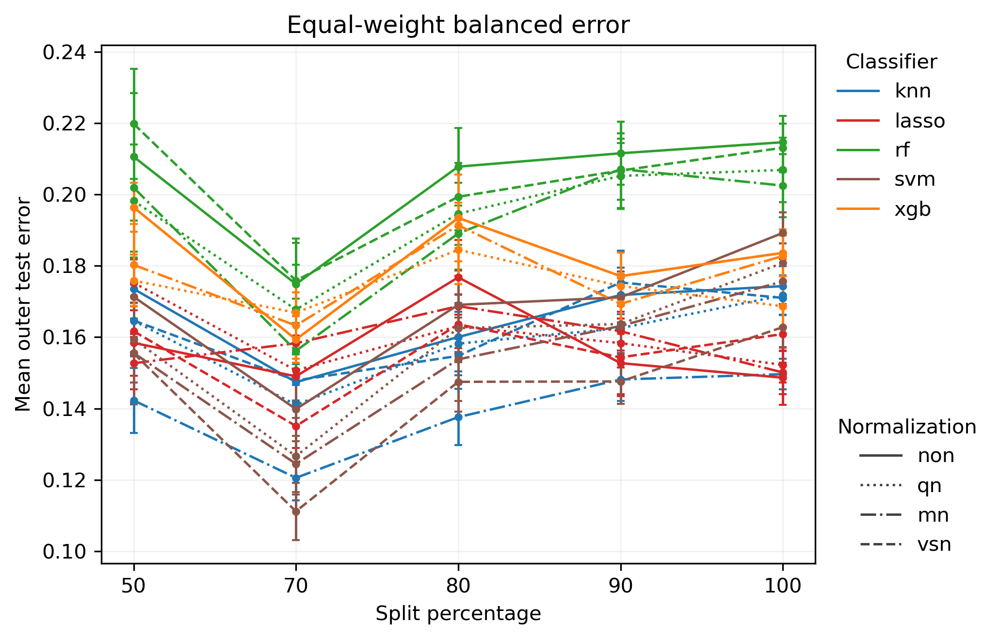
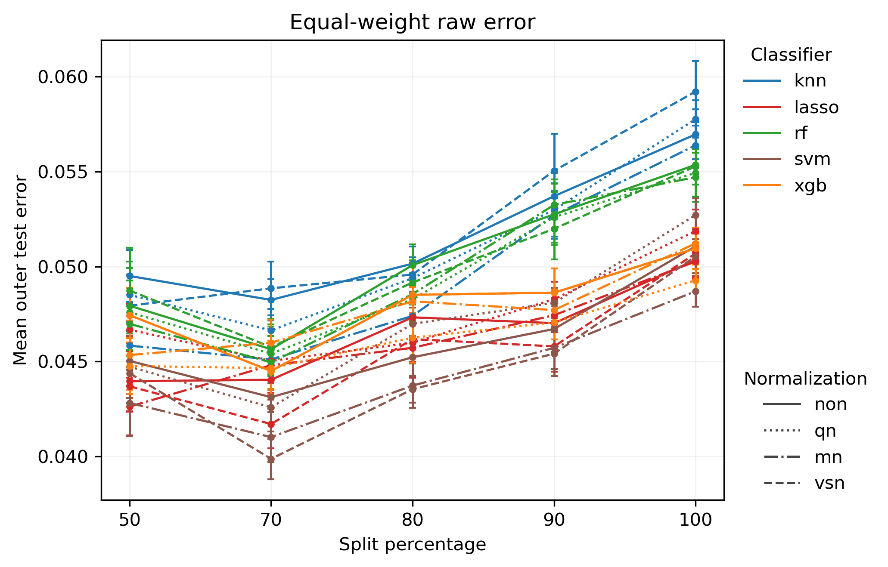
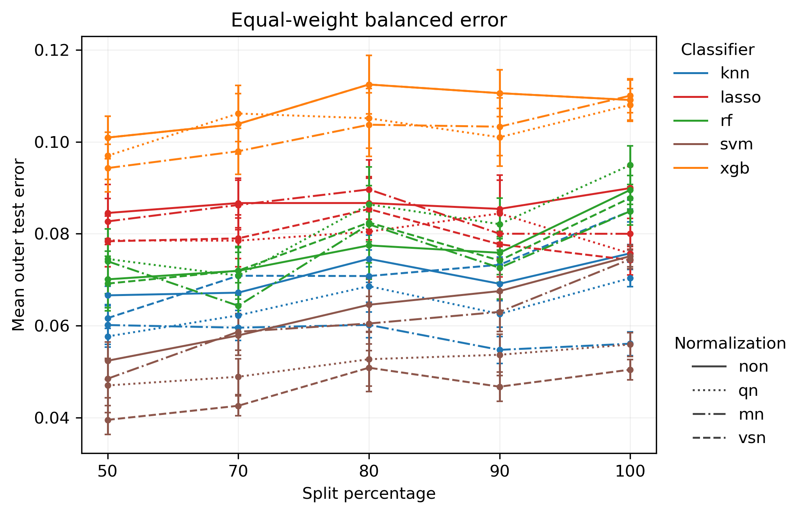
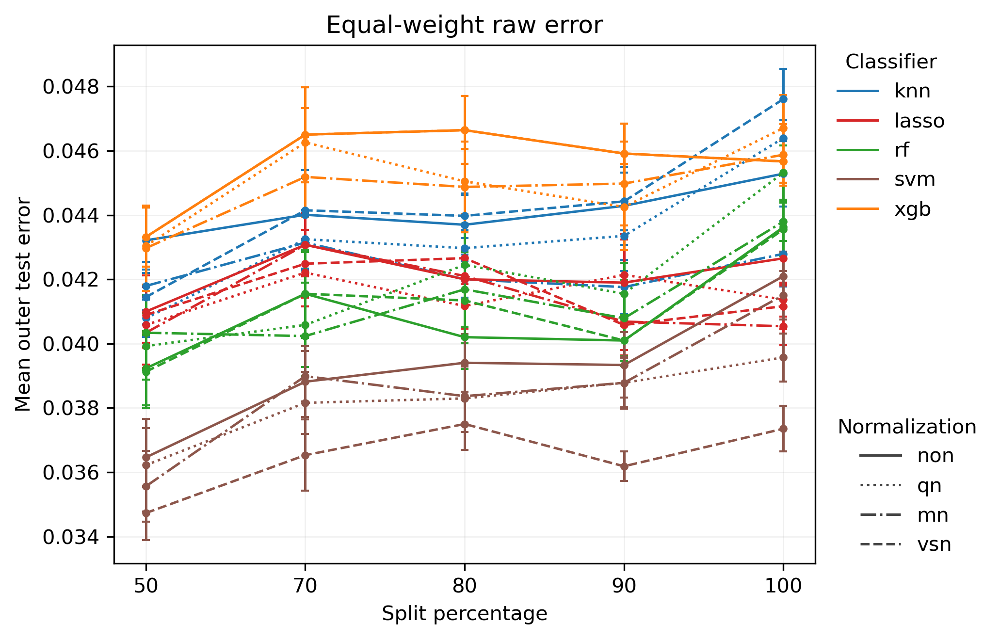
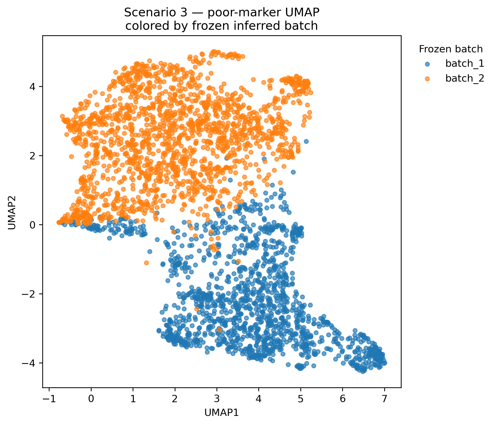
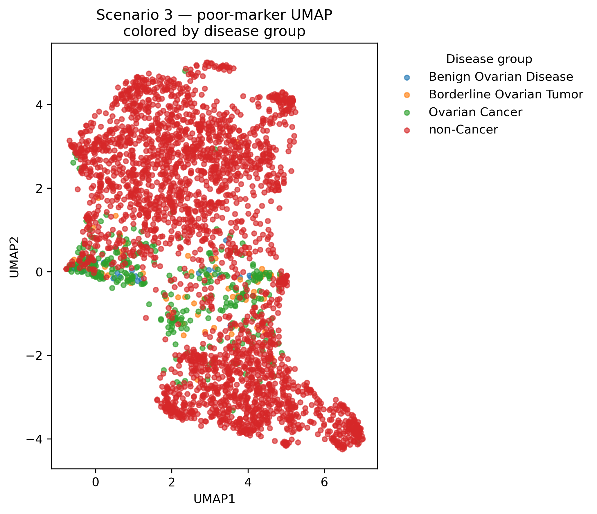
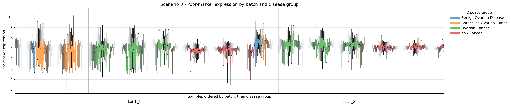

# Yokoi S3 — Dual-Track Validation Result Interpretation

## Scenario context

The Yokoi analysis contains three related but clinically different classification tasks:

- **S1: Ovarian cancer vs non-cancer.**  
  This is mainly a cancer-detection problem. The model separates ovarian cancer from non-cancer samples.

- **S2: Ovarian cancer vs other cancers.**  
  The negative class contains breast, colorectal, esophageal, gastric, hepatocellular, lung, pancreatic cancer, and sarcoma. This is closer to a cancer-type discrimination problem.

- **S3: Ovarian cancer vs benign ovarian disease, borderline ovarian tumor, and non-cancer controls.**  
  This is a clinically mixed differential-diagnosis problem. The negative class includes both clearly non-cancer samples and ovarian conditions that are biologically and clinically closer to ovarian cancer.

Because the negative classes differ substantially across scenarios, the absolute error level should not be interpreted as a pure measure of batch effect. It also reflects the intrinsic medical difficulty of the classification task.

## Research purpose

As in S1 and S2, the Pro workflow separates the original SSV analysis into two complementary tracks:

- **Natural protocol = primary real-world analysis**: keeps the observed class prevalence in each batch and measures the total difficulty of cross-batch deployment.
- **Class-stratified protocol = sensitivity / mechanism analysis**: makes the class composition of the batches more comparable, reducing the influence of class-prevalence shift and allowing the remaining degradation to be interpreted more directly as batch/domain shift.

For S3, the difference between these two tracks is itself an important result.

---

## S3 results

### 1. Class-stratified protocol

*Figure 1. S3 — Class-stratified protocol: equal-weight balanced error.*

*Figure 2. S3 — Class-stratified protocol: equal-weight raw error.*

The class-stratified curves are noticeably denser and more irregular than the Natural curves. Many classifier-normalization combinations move together, and several curves show a marked dip around split 70 followed by recovery at split 80–100.

The raw-error curves are more orderly than the balanced-error curves, but the same general pattern is visible: split 100 is usually higher than split 70 and often higher than split 50. Therefore, stricter batch separation still tends to worsen performance, although the relationship is clearly not monotone.

The balanced-error panel is especially informative. Errors are much larger than the corresponding raw errors, roughly in the 0.12–0.22 range for many settings, while raw error stays around 0.04–0.06. This gap shows that a low overall misclassification rate can hide substantial class-specific difficulty.

The irregularity of the class-stratified curves also matters. Once class prevalence is explicitly controlled, the relative ordering of classifiers becomes less clean and the split-to-split variation becomes larger. This suggests that, in S3, part of the apparent structure seen under the Natural protocol is tied to the original class composition. After that composition is constrained, the remaining batch/domain effect is harder to summarize by one smooth curve.

A second possibility is that class-stratified sampling reduces the effective sample size within some batch × class cells, which would naturally increase variability. This interpretation should be checked against `split_manifest.csv` before being treated as a confirmed mechanism.

---

### 2. Natural protocol

*Figure 3. S3 — Natural protocol: equal-weight balanced error.*

*Figure 4. S3 — Natural protocol: equal-weight raw error.*

The Natural curves look very different from the class-stratified curves.

First, the classifiers are much more clearly separated. In the balanced-error panel, SVM tends to occupy the lowest band, KNN and RF remain in the middle, LASSO is higher, and XGB is generally the highest. The raw-error panel shows the same broad layering, although the differences are smaller.

Second, the Natural curves are flatter. For many classifier-normalization combinations, error changes only modestly between split 50 and split 100. The curves are therefore easier to interpret as stable classifier-specific performance levels rather than as one common rising batch-effect pattern.

This does **not** mean that batch effect disappears under the Natural protocol. Some methods still worsen toward split 100. However, compared with S1 and S2, S3 shows a weaker and more method-dependent split trend in the Natural setting.

---

## A distinctive feature of S3: Natural and Class-stratified give very different curve structures

This is the most important feature of S3.

Under **Natural**, the curves are relatively smooth and clearly separated by classifier. Under **Class-stratified**, the curves become more compressed and more irregular.

That difference suggests that class composition is not just a minor nuisance variable in S3. It interacts strongly with the observed model performance.

In practical terms:

- under Natural sampling, the original prevalence structure helps determine which classifiers appear easier or harder;
- after class prevalence is controlled, those classifier bands become less distinct and the split effect becomes more variable;
- therefore, the S3 result cannot be summarized as a single “batch effect” without also considering class composition.

This is exactly why the dual-track design is useful. If only the Natural result were shown, one might conclude that S3 mainly reflects stable differences between classifiers. If only the Class-stratified result were shown, one might conclude that the batch effect is highly irregular. Looking at both together shows that **class prevalence and batch/domain shift are interacting rather than acting independently**.

A cautious interpretation is:

\[
\text{Observed S3 degradation}
=
\text{batch/domain shift}
+
\text{class-composition effect}
+
\text{their interaction}.
\]

The Pro workflow does not fully identify these three terms causally, but it makes their mixture visible.

---

## S1 vs S2 vs S3: medical task difficulty

The three scenarios represent different clinical questions, so their error levels should be compared in that context.

### S1 — Ovarian cancer vs non-cancer

S1 is the easiest of the three tasks in the current results. Raw errors are very low for most models, and balanced errors are also much lower than in S2.

This is reasonable because the model can exploit broad differences between cancer and non-cancer samples.

### S2 — Ovarian cancer vs other cancers

S2 is substantially harder. The negative class is made up entirely of other malignancies, so the classifier cannot rely simply on a generic cancer signal. It must learn features that are more specific to ovarian cancer.

This is reflected in clearly higher raw and balanced errors and in the strong classifier-specific performance bands.

### S3 — Ovarian cancer vs benign/borderline/non-cancer controls

S3 is different from both S1 and S2.

Its **raw error is relatively low**, closer to S1 than to S2, but its **balanced error can be much higher**, especially under the class-stratified protocol. This indicates that the task is not uniformly difficult across classes.

Clinically, this makes sense: the negative group is heterogeneous. Some samples are ordinary non-cancer controls, which may be easy to distinguish, while benign ovarian disease and borderline ovarian tumors are much closer to ovarian cancer and may be substantially harder.

So S3 should not be called simply “easier” or “harder” based on raw error alone. A better description is:

- S1: easiest overall cancer-vs-control discrimination;
- S2: hardest broad cancer-type discrimination;
- S3: heterogeneous differential-diagnosis problem, with low overall raw error but much greater class-specific difficulty.

This distinction is important when comparing batch effects. A larger balanced error in S3 does not necessarily imply a larger technical batch effect; it may also reflect the clinical heterogeneity of the negative class.

---

## Cross-scenario interpretation

Across S1–S3, two dimensions should be kept separate:

\[
\text{baseline medical classification difficulty}
\]

and

\[
\text{additional degradation caused by stronger batch separation}.
\]

The absolute error level addresses the first question. The change from split 50 to split 100 addresses the second.

From the current plots:

- **S1** has the lowest baseline error and shows a clear increase under strict batch separation.
- **S2** has the highest overall classification difficulty and strong classifier-specific stratification; strict batch separation also generally worsens performance.
- **S3** has a more complicated structure: raw error is modest, but balanced error is much higher, and the Natural and Class-stratified protocols produce very different curve shapes.

This makes S3 the clearest example of why the Pro framework needs both protocols. The Natural analysis alone would miss how strongly class composition affects the interpretation, while the Class-stratified analysis alone would miss the more stable deployment-level behavior seen under the observed population structure.

---

## Overall interpretation

S3 does not produce one simple monotone SSV curve. Instead, it shows that the conclusion depends strongly on whether the original class composition is preserved.

The Natural protocol produces relatively smooth, classifier-separated curves, suggesting stable algorithm-specific differences under the observed population structure. The Class-stratified protocol produces denser and more variable curves, indicating that once class prevalence is controlled, the remaining batch/domain effect is less uniform and more sensitive to classifier, normalization, and split construction.

Therefore, the main S3 conclusion is not merely that “error increases with batch separation.” The more important result is that **class composition materially changes how batch-associated degradation appears**.

This makes S3 a strong example of the methodological value of the dual-track design: it separates the real-world deployment view from the mechanism-oriented view and reveals that, for this clinically heterogeneous task, the two views are not interchangeable.

## Concise conclusion

Yokoi S3 is a heterogeneous differential-diagnosis problem in which ovarian cancer is compared with benign ovarian disease, borderline ovarian tumors, and non-cancer controls. Its Natural and Class-stratified results differ much more than in S1 or S2. Natural curves are relatively smooth and clearly separated by classifier, while Class-stratified curves are denser and more irregular. This suggests that class composition plays a substantial role in the observed performance structure and interacts with batch/domain shift. S3 therefore provides the strongest evidence among the three scenarios that real-world degradation and mechanism-level batch effects should be analyzed separately rather than summarized by a single SSV curve.

## Batch-structure QC

The S3 QC figures provide additional context for why the Natural and Class-stratified protocols behave so differently. These plots do not redefine the frozen batches; they are diagnostic visualizations of the poor-marker expression space and the existing frozen batch assignments.

### UMAP colored by frozen inferred batch

*Figure 5. S3 — Poor-marker UMAP colored by frozen inferred batch.*

The frozen-batch UMAP shows a very strong separation between the two inferred batches. Most `batch_2` samples occupy the upper part of the embedding, while most `batch_1` samples occupy the lower part, with only a relatively narrow transition region between them.

This confirms that the poor-marker expression space contains a strong batch-associated structure. The frozen batch labels therefore correspond to a visible organization in the data rather than an arbitrary split.

### UMAP colored by disease group

*Figure 6. S3 — Poor-marker UMAP colored by disease group.*

The disease-colored UMAP shows a more complicated pattern than S1 or S2. The disease groups do not reproduce the batch partition exactly, but they are also not randomly mixed across the embedding. Non-cancer samples dominate large portions of both the upper and lower regions, while ovarian cancer, benign ovarian disease, and borderline ovarian tumor are more concentrated around the central transition region and selected local areas.

This means that S3 has both a strong batch structure and a non-negligible disease-composition structure in the same expression space. Compared with S2, where the cancer types are much more intermixed, the S3 disease labels are more visibly aligned with the geometry of the batch-associated embedding.

A useful summary is:

\[
\boxed{
\text{strong batch-associated structure}
\quad+\quad
\text{non-negligible batch–disease entanglement}
}
\]

This does not mean that the frozen batch labels are simply copies of the disease labels. The two patterns are clearly not identical. However, it does mean that batch and disease composition are not fully independent in S3.

### Poor-marker sample-wise boxplot

*Figure 7. S3 — Sample-wise poor-marker expression by batch and disease group.*

The sample-wise boxplot supports the same interpretation. All four disease groups appear within the batch structure, but their expression distributions and dispersion are not identical. Ovarian cancer, benign ovarian disease, borderline ovarian tumor, and non-cancer samples show different local patterns, and those biological differences are superimposed on the batch-level expression shift.

The poor-marker variation in S3 is therefore better viewed as a mixture of:

\[
\text{batch variation}
+
\text{disease-group variation}
+
\text{composition differences}.
\]

### Link to the Natural vs Class-stratified result

These QC plots give a structural explanation for the unusually large difference between the two S3 analysis tracks.

Under the **Natural** protocol, the original disease composition is retained. The resulting error curves are relatively smooth and show clear classifier-specific separation. Under the **Class-stratified** protocol, the class composition is actively constrained, and the curves become denser and more irregular.

The QC results suggest that this is not surprising: in S3, class composition is closely connected to the geometry of the batch-associated expression space. Changing the class composition therefore changes more than the overall positive/negative proportion; it also changes which parts of that structured expression space contribute to the train and test sets.

This is consistent with the earlier S3 interpretation that the observed degradation reflects a mixture of batch/domain shift, class-composition effects, and their interaction.

These figures should still be treated as structural QC rather than as quantitative estimates of batch effect. The main quantitative evidence remains the split-dependent error curves, the Natural vs Class-stratified comparison, and the direction-aware summaries.
