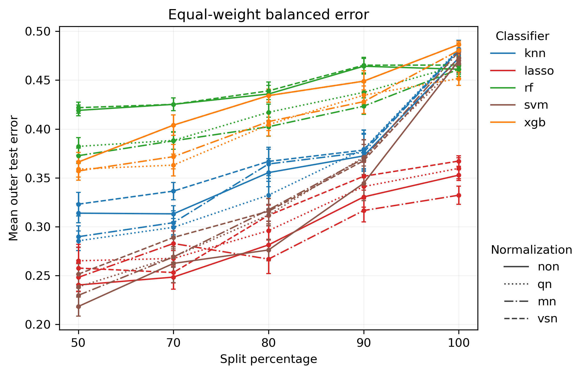
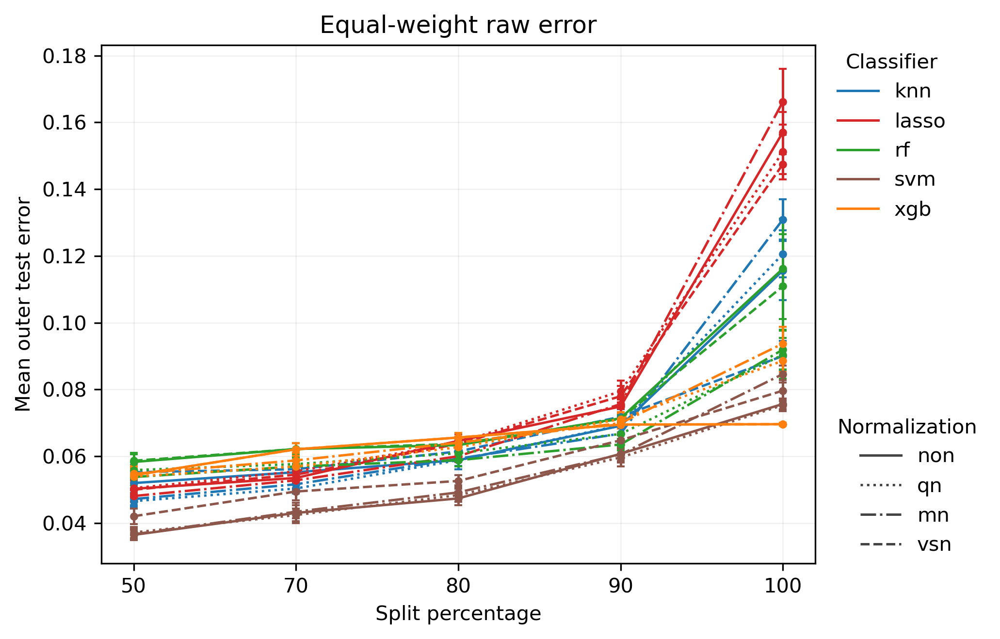
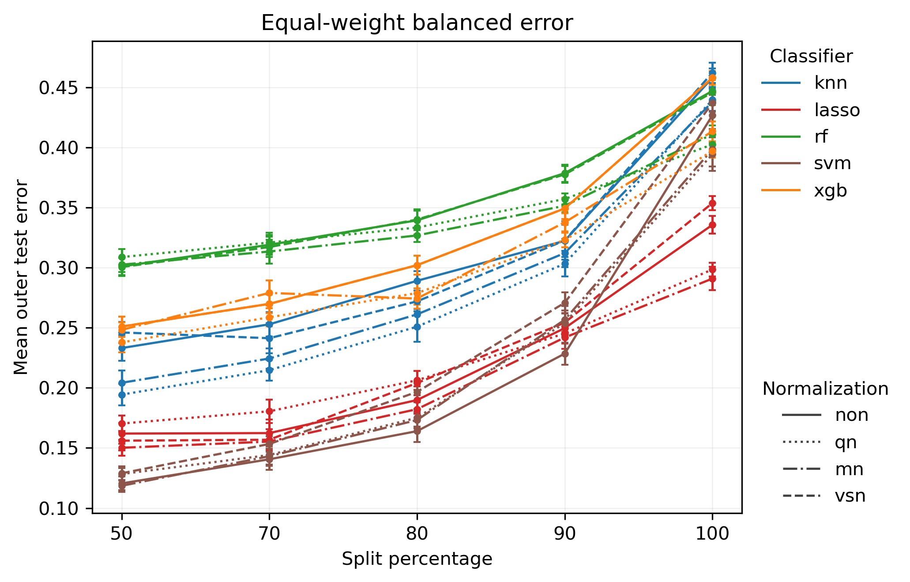
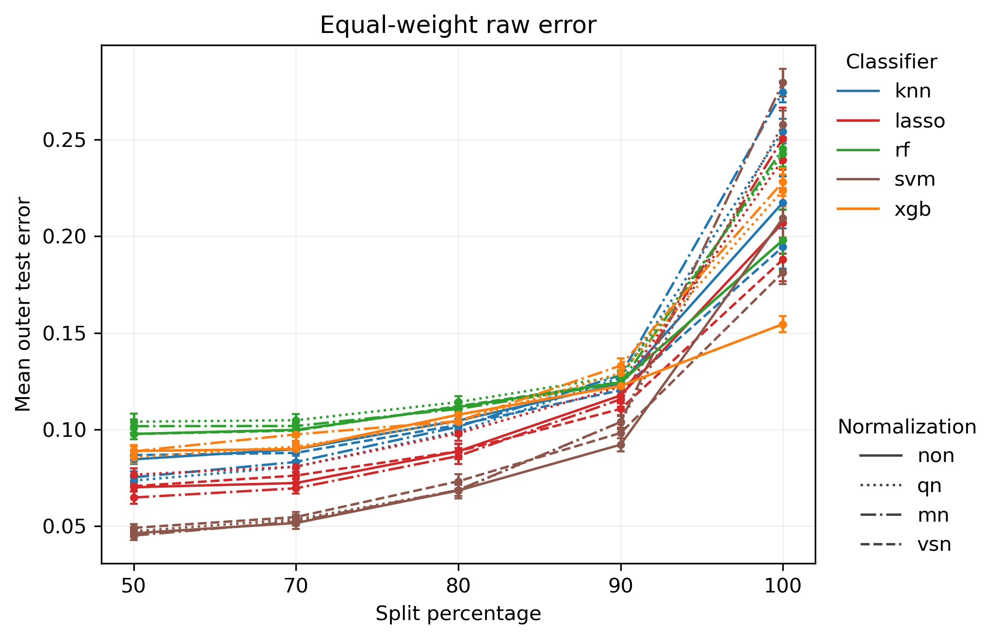

# JAMA Pro S1 — Dual-Track Validation Result Interpretation

## Research purpose

This Pro analysis separates the JAMA Scenario 1 evaluation into two complementary tracks:

- **Natural protocol = primary real-world analysis**: preserves the observed class prevalence in each batch and therefore reflects the total difficulty of cross-batch deployment under the observed data distribution.
- **Class-stratified protocol = sensitivity / mechanism analysis**: approximately matches class composition across batches, reducing the contribution of prevalence differences so that the remaining degradation can be interpreted more directly as batch/domain shift.

The purpose of the dual-track design is to distinguish total deployment degradation from the component that remains after controlling class composition.

## Medical context of the three JAMA scenarios

The original JAMA Oncology study evaluated three distinct diagnostic tasks:

- **Scenario 1 — Lung cancer vs all other individuals**: lung-cancer patients are distinguished from a heterogeneous background consisting of nontumor lung disease (NTLD), other diseases not affecting the lung, and unaffected controls. This is the broad **general lung-cancer detection** problem.
- **Scenario 2 — Lung cancer vs nontumor lung disease**: lung-cancer patients are distinguished specifically from patients with nonmalignant pulmonary disease. This is a more focused **differential diagnosis** problem within clinically relevant lung disease.
- **Scenario 3 — Early-stage lung cancer vs individuals without lung cancer**: stage I/II lung-cancer patients are distinguished from all non-lung-cancer individuals. This is the **early-detection** problem.

The original study cohort sizes were approximately:

| Scenario | Positive class | Negative class | Original comparison |
|---|---|---|---:|
| S1 | Lung cancer | NTLD + other diseases + controls | 606 vs 2440 |
| S2 | Lung cancer | NTLD | 606 vs 593 |
| S3 | Stage I/II lung cancer | All non-lung-cancer individuals | 194 vs 2440 |

These differences matter when later comparing S1, S2, and S3 because the three scenarios do not represent the same medical classification problem.

## S1 results

Scenario 1 is the broadest JAMA task:

> **Lung cancer vs all other individuals.**

The original cohort is strongly imbalanced: 606 lung-cancer samples versus 2440 non-lung-cancer samples. This imbalance is central to interpreting the large difference between raw error and balanced error.

### 1. Class-stratified protocol

*Figure 1. JAMA Pro S1 — Class-stratified protocol: equal-weight balanced error.*

Under the class-stratified protocol, most classifier–normalization combinations show increasing balanced error as the split percentage becomes more batch-separated. The deterioration is particularly pronounced near split = 100.

Lasso is the most consistently robust classifier family in this panel. By contrast, random forest and XGBoost already show comparatively high balanced error at easier splits and approach poor discrimination under strict batch separation. KNN and SVM also deteriorate substantially by split = 100.

The key point is that the error increase remains after class composition has been made more comparable across batches. Therefore, the degradation cannot be explained by class-prevalence shift alone; a genuine batch/domain component remains.

*Figure 2. JAMA Pro S1 — Class-stratified protocol: equal-weight raw error.*

The raw-error curve looks much more optimistic. At split 50–90, many classifier–normalization combinations remain around only a few percent error, and even at split = 100 the raw error is far below the corresponding balanced error.

This divergence is one of the most important findings in S1.

### 2. Natural protocol

*Figure 3. JAMA Pro S1 — Natural protocol: equal-weight balanced error.*

The Natural protocol preserves the observed class prevalence and therefore represents the total cross-batch deployment difficulty. The same qualitative pattern appears: error rises with stricter batch separation, especially between split 90 and split 100.

At the easier splits, SVM and lasso are comparatively strong. Lasso remains relatively stable as the split becomes stricter, whereas KNN, RF, SVM, and XGB show larger deterioration for several normalization settings.

*Figure 4. JAMA Pro S1 — Natural protocol: equal-weight raw error.*

Natural raw error also increases as batch separation becomes stricter. The increase becomes particularly sharp at split = 100. Nevertheless, the raw-error values remain substantially below the corresponding balanced-error values.

The Natural and Class-stratified tracks therefore support the same high-level conclusion: stricter cross-batch validation is substantially harder, and this degradation persists even when class-prevalence differences are reduced.

### 3. Raw error vs balanced error — the distinctive S1 phenomenon

The most striking feature of Scenario 1 is:

\[
E_{\text{balanced}} \gg E_{\text{raw}}.
\]

Raw error is the ordinary overall misclassification fraction:

\[
E_{\text{raw}}
=
\frac{\#\{\text{misclassified samples}\}}
     {\#\{\text{all samples}\}}.
\]

Balanced error gives the two classes equal importance:

\[
E_{\text{balanced}}
=
\frac{1}{2}
\left(
E_{\text{LCa}}
+
E_{\text{non-LCa}}
\right).
\]

Because S1 contains many more non-LCa samples than LCa samples, raw error is dominated by performance on the majority non-LCa class. A model can therefore achieve a very low raw error while still performing much worse on the minority lung-cancer class.

The large gap between the two metrics implies that the errors are strongly asymmetric across classes. In practical terms:

\[
\boxed{
\text{low overall error does not mean equally good lung-cancer detection}
}
\]

This is clinically important. In a lung-cancer detection task, a model that classifies the majority non-cancer population well but misses a substantial fraction of cancer cases can still look strong under raw error.

Balanced error exposes this weakness because it gives lung cancer and non-lung cancer equal weight.

This interpretation is also consistent with the original JAMA Scenario 1 result, where specificity was higher than sensitivity: the original validation reported sensitivity of about 82.8% and specificity of about 93.5%. In other words, lung-cancer cases were harder to recover than non-lung-cancer cases.

Therefore, for Scenario 1:

\[
\boxed{
\text{balanced error should be treated as the primary robustness metric}
}
\]

while raw error is useful for showing what the observed overall deployment error would look like under the corresponding prevalence.

### 4. Classifier robustness

#### Lasso

Lasso is the most consistently robust classifier family across the four S1 plots. It generally has the lowest or near-lowest balanced error and deteriorates less severely than the tree-based methods under split = 100.

This suggests that the sparse linear decision boundary is comparatively stable under the JAMA cross-batch shift.

#### SVM

SVM performs very well at the easier splits, especially under Natural prevalence, but its performance becomes more normalization-dependent and degrades substantially under the strictest batch separation.

#### KNN

KNN performs intermediately at easier splits but deteriorates strongly at split = 100, consistent with sensitivity of local-neighborhood geometry to batch-induced shifts in feature space.

#### Random forest and XGBoost

RF and XGB show relatively high balanced error even at split 50 and generally worsen further with increasing split percentage. Their raw errors may still look modest, which again demonstrates why balanced error is essential in S1.

### 5. Normalization effects

Normalization changes the exact curves, but visually its effect is generally smaller than the effects of:

1. split severity, and
2. classifier choice.

A reasonable qualitative hierarchy from these plots is:

\[
\boxed{
\text{batch split severity}
>
\text{classifier choice}
>
\text{normalization choice}
}
\]

This should later be confirmed quantitatively from the raw result tables rather than treated as a formal ranking based only on visual inspection.

## Batch-structure diagnostic

### Original three-batch poor-marker expression

*Figure 5. JAMA Pro S1 — Poor-marker expression across the original three inferred batches and disease groups.*

The original three-batch diagnostic shows a strong batch-associated shift in poor-marker expression. Batch 1 has markedly lower expression than batches 2 and 3, while the LCa and Non-LCa distributions overlap substantially within each batch.

This is the pattern expected from a useful batch diagnostic:

\[
\boxed{
\text{batch-associated variation}
>
\text{disease-associated variation}
}
\]

The poor-marker panel therefore appears to be capturing technical/domain structure rather than simply reproducing the lung-cancer classification signal. This supports the use of these markers for visualizing the batch structure that underlies the SSV stress test.

The within-batch overlap between LCa and Non-LCa is especially important. If the poor-marker distributions separated strongly by disease label inside each batch, the diagnostic would be difficult to interpret because batch and disease signal would be entangled. Instead, the dominant separation is across batches.

### Pro two-meta-batch diagnostic

*Figure 6. JAMA Pro S1 — Poor-marker expression after collapsing the original batches into two Pro meta-batches.*

After the original three inferred batches are collapsed into the two Pro meta-batches, a substantial domain contrast remains. However, the second meta-batch is visibly heterogeneous: it contains distinct lower-expression and higher-expression regimes inherited from the original batch structure.

Therefore, the Pro construction should **not** be interpreted as producing two internally homogeneous domains.

A more accurate interpretation is:

\[
\boxed{
\text{between-meta-batch shift}
+
\text{within-meta-batch heterogeneity}
}
\]

The meta-batch design preserves a meaningful cross-domain contrast for stress testing, but one meta-batch still contains substantial internal structure. This makes the Pro task stricter than a simple comparison between two cleanly separated homogeneous domains.

### Connection to the result curves

These diagnostics provide a plausible mechanistic explanation for the Scenario 1 performance curves.

As the split becomes increasingly batch-separated, the models are asked to generalize across expression regimes that differ substantially in the poor-marker space. The resulting increase in outer-test error is therefore consistent with genuine batch-associated distribution shift.

The important sequence is:

\[
\boxed{
\text{batch-associated expression shift}
\rightarrow
\text{stronger train/test domain separation}
\rightarrow
\text{worse outer-test generalization}
}
\]

This visual evidence complements the dual-track result curves.

The Class-stratified protocol shows that degradation remains after reducing prevalence differences, while the poor-marker diagnostics independently show that substantial batch-related expression differences exist. Together, these two pieces of evidence strengthen the interpretation that the Scenario 1 degradation is not merely a class-imbalance artifact.

At the same time, the internal heterogeneity of the second meta-batch means that the Pro experiment should be interpreted as a realistic domain-shift stress test rather than as a perfectly controlled two-domain experiment.

## Overall interpretation

Both Natural and Class-stratified analyses lead to the same central S1 conclusion:

\[
\boxed{
\text{stricter batch separation produces substantially worse generalization}
}
\]

The deterioration remains visible after class composition is controlled, so class-prevalence shift alone cannot explain the result. This supports the presence of a genuine batch/domain effect.

At the same time, S1 has a second, unusually important feature:

\[
\boxed{
\text{raw error substantially understates class-level difficulty}
}
\]

because the task is strongly imbalanced. Balanced error reveals that many models are much closer to poor class discrimination than their overall raw error would suggest.

A useful causal interpretation is therefore:

\[
\boxed{
\text{batch shift}
\rightarrow
\text{class-conditional degradation}
\rightarrow
\text{large balanced-vs-raw error gap}
}
\]

rather than simply:

\[
\text{batch shift}
\rightarrow
\text{uniform increase in error}.
\]

## Cross-scenario comparison framework for S2 and S3

S1 will be used as the reference scenario when S2 and S3 are added.

The later comparison should explicitly distinguish the medical tasks:

- **S1**: broad cancer detection against a heterogeneous non-cancer background.
- **S2**: cancer vs nonmalignant lung disease; a clinically focused differential-diagnosis problem.
- **S3**: early-stage cancer vs all non-cancer individuals; a biologically subtler early-detection problem.

For each later scenario, compare:

1. baseline error at split 50;
2. degradation from split 50 to split 100;
3. balanced-vs-raw error gap;
4. classifier ranking stability;
5. normalization sensitivity;
6. Natural vs Class-stratified sensitivity;
7. whether the clinically harder task is also more batch-sensitive.

The final cross-scenario question is:

\[
\boxed{
\text{Does medical classification difficulty align with batch-shift sensitivity?}
}
\]

This cannot be answered from S1 alone; it should be evaluated only after the corresponding S2 and S3 Pro curves are added.

## Concise conclusion

For JAMA Pro Scenario 1, most models show increasing outer-test error as the validation split becomes more batch-separated, with the strongest deterioration at split = 100. The same pattern persists under both Natural and Class-stratified protocols, indicating that class-prevalence shift does not fully explain the degradation and that a genuine batch/domain effect remains.

The distinctive S1 result is the very large gap between raw error and balanced error. Because S1 is strongly class-imbalanced, raw error is dominated by the majority non-LCa class and can make model performance appear substantially better than the equal-weighted class performance actually is. Balanced error therefore reveals clinically important class-specific degradation that aggregate raw error conceals.

Among classifiers, lasso is the most consistently robust across the S1 curves, while RF and XGB show relatively weak balanced-error performance. These findings make S1 a useful reference for later determining whether the medically different S2 and S3 tasks are intrinsically harder, more batch-sensitive, or both.
