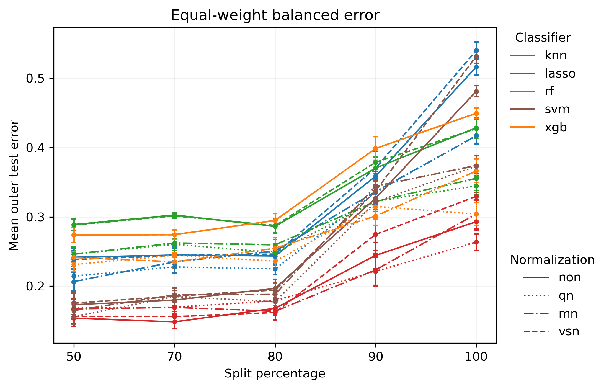
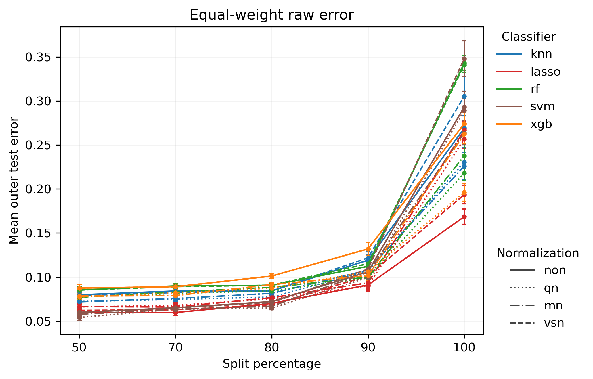
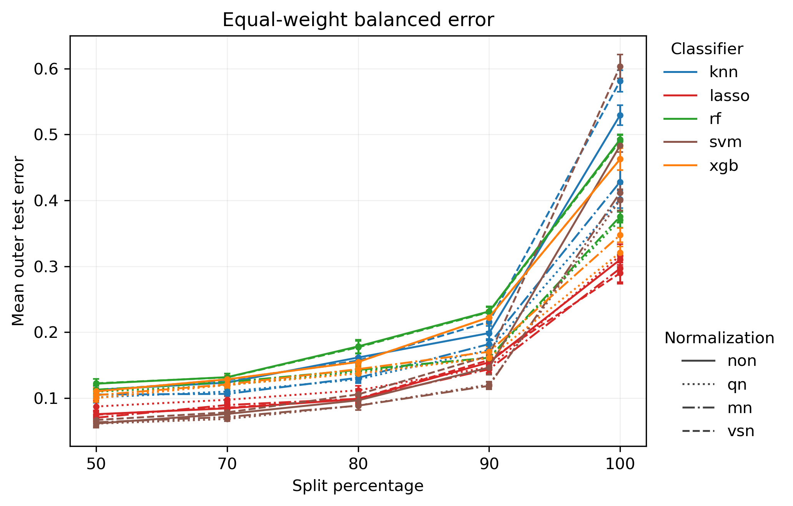
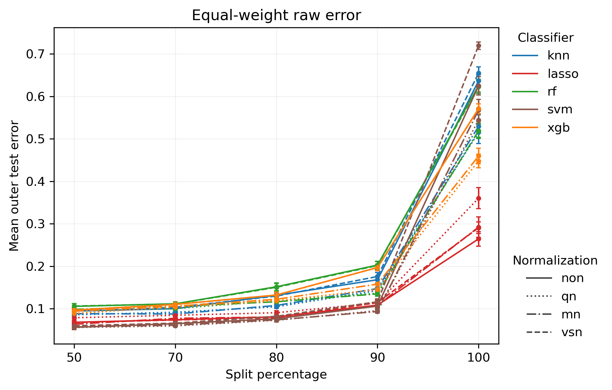

# JAMA Pro S2 — Dual-Track Validation Result Interpretation

## Research purpose

This Pro analysis evaluates JAMA **Scenario 2** under two complementary validation tracks:

- **Natural protocol = primary deployment-oriented analysis.** It preserves the observed class prevalence in each batch and therefore reflects total cross-batch deployment difficulty under the observed data distribution.
- **Class-stratified protocol = sensitivity / mechanism analysis.** It approximately equalizes class composition across batches so that the remaining degradation can be interpreted more directly as batch/domain shift rather than class-prevalence shift.

The purpose of the dual-track design is to distinguish overall deployment degradation from the component that persists after class-composition differences are reduced.

## Medical context of the three JAMA scenarios

The original JAMA Oncology study evaluated three clinically distinct classification tasks:

- **Scenario 1 (S1) — lung cancer vs all other individuals.**  
  The negative class contains nontumor lung disease (NTLD), other diseases, and unaffected controls. This is the broadest **general lung-cancer detection** problem.
- **Scenario 2 (S2) — lung cancer vs nontumor lung disease.**  
  The negative class contains **NTLD only**. This is a focused **differential diagnosis** task within clinically relevant pulmonary disease.
- **Scenario 3 (S3) — stage I/II lung cancer vs individuals without lung cancer.**  
  This is the **early-detection** task, where the positive class is restricted to early-stage lung cancer.

These scenarios should not be interpreted as the same medical task with different sample subsets. They represent different biological and clinical discrimination problems.

A useful summary is:

| Scenario | Medical task | Positive class | Negative/background class |
|---|---|---|---|
| S1 | General lung-cancer detection | Any lung cancer | NTLD + other diseases + controls |
| S2 | Differential diagnosis within pulmonary disease | Any lung cancer | NTLD |
| S3 | Early-detection | Stage I/II lung cancer | All non-lung-cancer individuals |

For S2 specifically, the original study compared **606 lung-cancer cases vs 593 NTLD cases**, making it the most class-balanced of the three scenarios.

## Why S2 is medically different from S1

S2 is not a generic “cancer vs non-cancer” problem. It asks whether the classifier can separate **lung cancer** from **nonmalignant lung disease**.

That makes S2 clinically important because it is closer to the real differential-diagnosis setting: both classes involve lung-related pathology, and they may share smoking-associated, inflammatory, and respiratory molecular signatures.

Therefore, compared with S1:

- the background class is more biologically similar to the positive class;
- the task is clinically narrower but potentially more challenging in terms of fine discrimination;
- class imbalance is much weaker, so raw error and balanced error are expected to be closer than in S1.

This expectation is strongly reflected in the Pro results.

## S2 results

### 1. Class-stratified protocol

*Figure 1. JAMA Pro S2 — Class-stratified protocol: equal-weight balanced error.*

Under the class-stratified protocol, the broad pattern is again increasing error as the split percentage becomes more batch-separated, but the most striking feature is the **discontinuous jump at split = 100**.

From split 50 to split 90, the curves increase only moderately for many classifier–normalization combinations. In contrast, moving from split 90 to split 100 causes a large upward jump for nearly all models.

This suggests that Scenario 2 is not characterized by smooth gradual degradation alone. Instead, it appears to hit a **transportability breakpoint** near the strictest validation regime.

A useful interpretation is:

\[
\boxed{
\text{split }100 \text{ behaves like a threshold where batch/domain mismatch becomes qualitatively harder}
}
\]

rather than merely a small incremental tightening of the validation split.

Within this panel, lasso remains the most robust classifier family overall. RF and XGB are clearly weaker, while KNN and SVM show substantial late deterioration, especially at split 100.

*Figure 2. JAMA Pro S2 — Class-stratified protocol: equal-weight raw error.*

The class-stratified raw-error panel shows the same fundamental pattern: modest growth through split 90, followed by a very strong jump at split 100.

Unlike S1, raw and balanced error are not separated by an enormous gap. Raw error is lower, but it broadly tracks the same structure.

This is exactly what we would expect from S2’s near-balanced class sizes. Because the cohort is much more balanced than in S1, the overall misclassification rate is less dominated by one class, so raw error and balanced error tell more similar stories.

### 2. Natural protocol

*Figure 3. JAMA Pro S2 — Natural protocol: equal-weight balanced error.*

The Natural protocol leads to the same central conclusion. Through split 50–90, many curves remain comparatively low and increase only gradually. At split 100, however, there is a large upward break across nearly all classifier families.

This is arguably the defining result of S2:

\[
\boxed{
\text{the strictest split is not just worse; it is qualitatively worse}
}
\]

The sharp break suggests that most of the predictive signal observed under moderate batch separation does not extrapolate smoothly into the strictest batch-held-out setting.

In this panel:

- **lasso** again appears most robust,
- **SVM** is competitive at easier splits but becomes unstable at split 100,
- **KNN** shows a substantial jump at split 100,
- **RF** and **XGB** perform worse overall and also jump sharply under the strictest split.

*Figure 4. JAMA Pro S2 — Natural protocol: equal-weight raw error.*

Natural raw error again mirrors the same pattern: relatively mild increases through split 90, followed by a dramatic jump at split 100.

Because S2 is close to class-balanced, raw error remains much more aligned with balanced error than in S1. This is a scientifically useful contrast between the two scenarios.

## The distinctive S2 phenomenon: the split-100 discontinuity

The most important feature of Scenario 2 is not primarily a raw-vs-balanced discrepancy. Instead, it is the **split-100 cliff**.

Across all four S2 panels, the move from split 90 to split 100 is visually much larger than the earlier increments. This suggests that the strictest split is exposing something qualitatively different about the task.

A plausible interpretation is:

\[
\boxed{
\text{under moderate batch separation, the classifier still sees enough shared disease structure;}
}
\]

but

\[
\boxed{
\text{under the strictest held-out batch setting, the disease signal no longer transports well enough across domains.}
}
\]

Because S2 compares lung cancer specifically against NTLD, the two classes may already be relatively close in biologically meaningful feature space. Under easier splits, the classifier can still exploit signal shared across batches. Under split 100, however, the remaining distribution shift may remove enough of that stable signal that the discrimination problem becomes substantially harder.

In other words, S2 appears to exhibit:

\[
\boxed{
\text{domain-stability up to a point}
\rightarrow
\text{then a sharp failure regime}
}
\]

rather than a purely smooth monotone deterioration.

This makes S2 especially interesting mechanistically.

## Raw error vs balanced error in S2

In S2, raw and balanced error differ, but the gap is much smaller than in S1.

That is exactly what should happen when class sizes are much more balanced.

Raw error is still defined as:

\[
E_{\text{raw}}
=
\frac{\#\{\text{misclassified samples}\}}
     {\#\{\text{all samples}\}}.
\]

Balanced error is:

\[
E_{\text{balanced}}
=
\frac{1}{2}
\left(
E_{\text{LCa}}
+
E_{\text{NTLD}}
\right).
\]

Since the class sizes are similar, raw error is no longer overwhelmingly dominated by one class. Therefore:

\[
\boxed{
\text{raw error is a more faithful summary metric in S2 than it was in S1}
}
\]

although balanced error is still preferable as the main robustness metric because it preserves symmetry between the two classes.

This contrast with S1 is important for later cross-scenario comparison:

- **S1** is dominated by a strong raw-vs-balanced discrepancy because of class imbalance.
- **S2** is dominated by a **split-100 discontinuity** because the classes are more balanced but apparently become much harder to separate under the strictest domain shift.

## Classifier robustness

### Lasso

Lasso is again the most consistently robust classifier family across the S2 curves. It has the lowest or near-lowest balanced error across most settings and remains best or among the best even after the split-100 jump.

This suggests that the sparse linear boundary remains the most stable under cross-batch transport stress.

### SVM

SVM is highly competitive at easier splits and often among the best-performing methods through split 80–90. However, it exhibits a pronounced jump at split 100, especially in the Natural protocol.

This suggests:

\[
\text{strong discrimination within moderate shift}
\quad+\quad
\text{weak strict-batch transportability}.
\]

### KNN

KNN performs moderately well at easier splits but undergoes one of the largest split-100 jumps. This is consistent with the vulnerability of neighborhood-based methods to changes in feature geometry across held-out domains.

### Random forest and XGBoost

RF and XGB are generally worse in balanced-error space and also show substantial discontinuous deterioration at split 100. Their behavior is consistent with reduced robustness under the strongest domain shift.

## Normalization effects

Normalization matters, but the visually dominant source of variation in S2 is not the choice of normalization. It is:

1. the split-100 transition;
2. classifier choice.

A reasonable qualitative summary is:

\[
\boxed{
\text{split-100 transition}
>
\text{classifier choice}
>
\text{normalization choice}
}
\]

Thus the major scientific message of S2 is not which normalization wins, but that the **strictest batch separation fundamentally changes the difficulty of the task**.

## Natural vs Class-stratified comparison

Natural and Class-stratified protocols yield the same high-level conclusion:

\[
\boxed{
\text{S2 remains relatively stable through split 90, then degrades sharply at split 100.}
}
\]

This agreement is important. It suggests that the split-100 failure is not merely a prevalence artifact.

The Class-stratified analysis reduces the role of class-composition differences, yet the discontinuity remains. Therefore, the jump is much more plausibly interpreted as a true domain-shift / batch-transport effect.

This is one of the cleanest scientific findings in S2.

## Supplementary batch-structure diagnostic

The following two boxplots are useful as **supplementary QC**, but they should not be treated as the main mechanistic evidence for Scenario 2 in the same way as they were for Scenario 1.

### Original three-batch poor-marker expression

*Figure 5. JAMA Pro S2 — Poor-marker expression across the original three inferred batches and disease groups.*

The original three-batch diagnostic still shows some visible batch-associated structure. In particular, one portion of the samples remains at a noticeably lower poor-marker expression level, while the other portions are centered more around the mid-expression regime.

However, compared with Scenario 1, the separation is not visually as strong or as clean. The LCa and NTLD distributions overlap substantially within most regions, and the batch-associated differences are more moderate.

This means the S2 poor-marker panel does **not** support a simple story of very large univariate batch separation.

A careful summary is:

\[
\boxed{
\text{there is visible batch structure, but it is only moderate in this one-dimensional diagnostic}
}
\]

### Pro two-meta-batch diagnostic

*Figure 6. JAMA Pro S2 — Poor-marker expression after collapsing the original batches into two Pro meta-batches.*

After collapsing the original three inferred batches into the two Pro meta-batches, the visible difference between the two meta-batches remains present but is still not especially dramatic. Much of the sample-level distribution in both meta-batches lies in a similar expression range, and there is substantial overlap between LCa and NTLD.

This is important for interpretation.

Unlike Scenario 1, where the poor-marker diagnostic gave a strong visual impression of batch-associated separation, Scenario 2 shows only a moderate domain contrast in this summary view. Therefore, the split-100 performance cliff should **not** be explained simply as a large global shift in sample-level poor-marker expression.

A better interpretation is:

\[
\boxed{
\text{the split-100 failure is likely driven by more complex multivariate domain shift}
}
\]

rather than by a very large one-dimensional marginal expression displacement visible in this plot.

### Why the S2 boxplots still matter

These boxplots are still worth including because they show two useful things.

First, they confirm that the Pro meta-batch construction is not arbitrary: there is still recognizable batch-related structure in the poor-marker space.

Second, they show that the dramatic split-100 jump in the S2 result curves cannot be reduced to a trivial visual explanation such as “the two meta-batches have massively different overall poor-marker levels.”

That is scientifically useful, because it suggests:

\[
\boxed{
\text{visible marginal batch separation strength}
\neq
\text{classifier transport failure strength}
}
\]

In other words, a low-dimensional univariate QC view may show only modest differences even while the multivariate classifier suffers a severe held-out-domain breakdown.

### Connection to the result curves

The main S2 result remains the split-100 discontinuity in both balanced and raw error. These supplementary diagnostics refine the interpretation of that result.

The figures suggest that:

1. there is some underlying batch/domain structure;
2. the structure is not overwhelmingly large in this compressed sample-level summary;
3. therefore the strict split-100 cliff is likely reflecting a more subtle transportability failure, such as:
   - multivariate covariance shift,
   - feature-specific instability,
   - support mismatch between training and held-out batches,
   - or interaction between disease discrimination and domain structure.

So the S2 boxplots do **not** weaken the main result. Instead, they sharpen it:

\[
\boxed{
\text{S2 performance collapse is real, but it is not fully visible from simple marginal expression summaries alone.}
}
\]

This makes Scenario 2 especially interesting when later compared against Scenario 1 and Scenario 3.

## Overall interpretation

The central Scenario 2 result is:

\[
\boxed{
\text{the main failure mode is a split-100 discontinuity rather than a large raw-vs-balanced gap}
}
\]

This distinguishes S2 from S1.

A concise causal interpretation is:

\[
\boxed{
\text{moderate batch shift}
\rightarrow
\text{manageable transport}
\rightarrow
\text{strict split-100 regime}
\rightarrow
\text{transport breakdown}
}
\]

The interpretation is clinically meaningful. Because S2 compares lung cancer against NTLD, the task is a true pulmonary differential-diagnosis problem. The fact that performance remains relatively controlled until split 90 but then collapses at split 100 suggests that the cancer-vs-NTLD signal contains a transportable core, but that this core is insufficient once the held-out batch/domain becomes maximally separated.

## How S2 should later be compared with S1 and S3

The final cross-scenario comparison should explicitly connect statistics to medical meaning.

### S1
General cancer detection against a heterogeneous background. The main phenomenon is the large gap between raw and balanced error because of strong class imbalance.

### S2
Differential diagnosis of lung cancer vs NTLD. The main phenomenon is the split-100 discontinuity, indicating a sharp transportability breakdown under the strictest domain shift.

### S3
Early-stage cancer detection. This will later need to be evaluated for both baseline difficulty and batch sensitivity, since early-stage disease is likely biologically subtler.

When S3 is added, the comparison should focus on:

1. baseline difficulty at split 50;
2. amount of increase from split 50 to 90;
3. size of the split-100 jump;
4. raw-vs-balanced discrepancy;
5. classifier ranking stability;
6. normalization sensitivity;
7. whether the clinically more subtle scenario is also more batch-sensitive.

The core final question will be:

\[
\boxed{
\text{Do different medical classification problems fail in different statistical ways under batch shift?}
}
\]

S1 already suggests one failure mode (imbalance-exposed class asymmetry), while S2 suggests a different one (threshold-like transport breakdown).

## Concise conclusion

For JAMA Pro Scenario 2, the most important pattern is a sharp increase in error at **split = 100** across both Natural and Class-stratified protocols. Through split 50–90, many classifier–normalization combinations remain relatively stable; under the strictest split, however, performance deteriorates abruptly. This indicates that Scenario 2 exhibits a threshold-like transportability failure rather than only smooth gradual degradation.

Unlike S1, Scenario 2 does not show an extreme separation between raw error and balanced error, which is consistent with the much more balanced class sizes in the original cohort. Instead, the dominant story is that the lung-cancer-vs-NTLD discrimination task appears to retain a transportable core under moderate batch shift, but that this signal breaks down under the strictest held-out domain setting.

Across classifier families, lasso is the most consistently robust, while KNN, SVM, RF, and XGB all show marked deterioration at split 100. Therefore, Scenario 2 should be remembered primarily as the **split-100 cliff scenario**, in contrast to Scenario 1, which is better characterized by the **raw-vs-balanced divergence scenario**.
