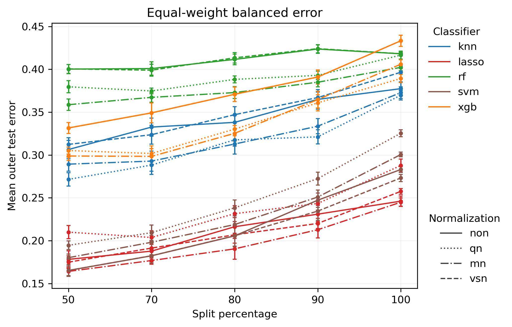
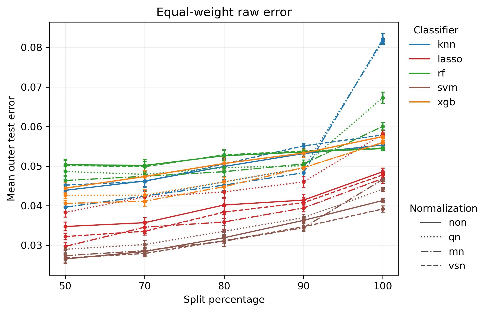
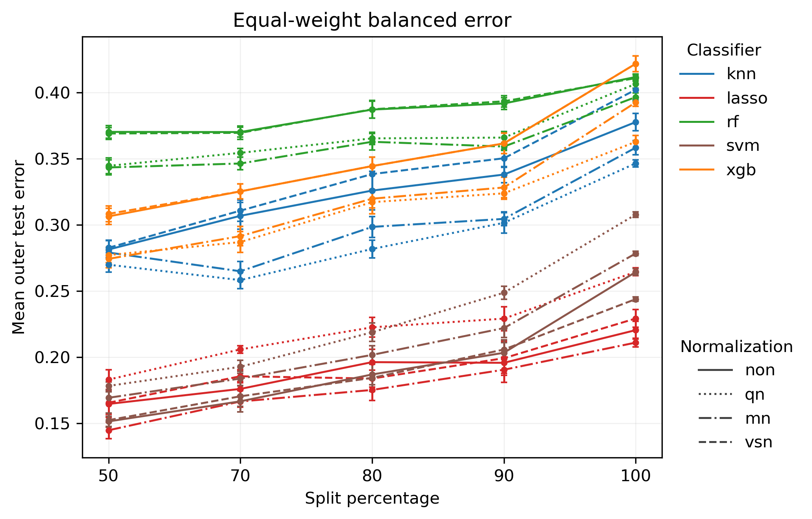
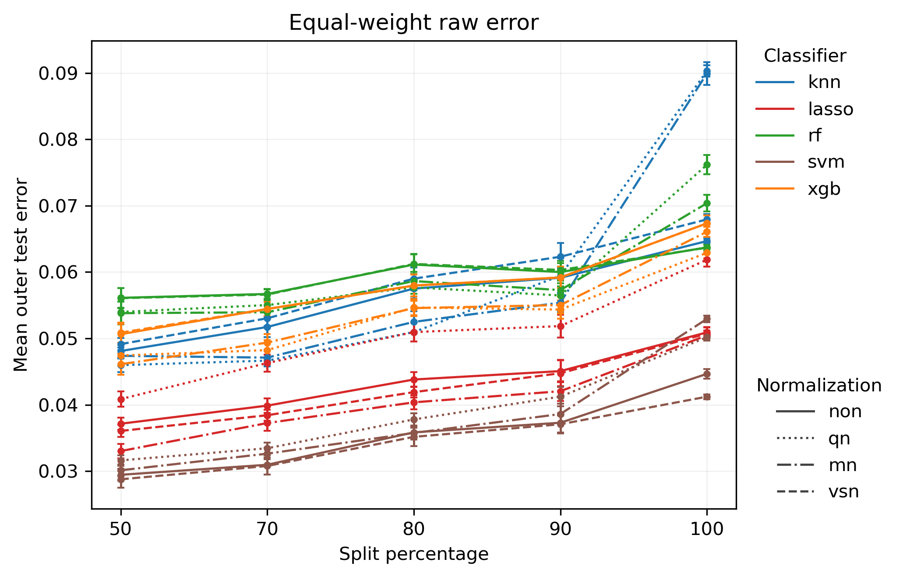

# JAMA Pro S3 — Dual-Track Validation Result Interpretation

## Research purpose

This Pro analysis evaluates JAMA **Scenario 3** under two complementary validation tracks:

- **Natural protocol = primary deployment-oriented analysis**: preserves the observed class prevalence in each batch and therefore reflects total cross-batch deployment difficulty under the observed data distribution.
- **Class-stratified protocol = sensitivity / mechanism analysis**: approximately matches class composition across batches so that the remaining degradation can be interpreted more directly as batch/domain shift rather than class-prevalence shift.

The purpose of the dual-track design is to separate total deployment degradation from the component that remains after class-composition differences are reduced.

## Medical context of the three JAMA scenarios

The original JAMA Oncology study evaluates three clinically distinct diagnostic tasks:

- **Scenario 1 (S1) — lung cancer vs all other individuals.**  
  This is the broad **general lung-cancer detection** task. The negative class contains nontumor lung disease (NTLD), other diseases, and unaffected controls.
- **Scenario 2 (S2) — lung cancer vs nontumor lung disease.**  
  This is a focused **differential-diagnosis** task within pulmonary disease: lung cancer must be separated specifically from nonmalignant lung disease.
- **Scenario 3 (S3) — stage I/II lung cancer vs individuals without lung cancer.**  
  This is the **early-detection** task. Only early-stage lung-cancer cases are treated as positive, while the negative/background class contains NTLD, other diseases, and unaffected controls.

The original paper reports approximately:

| Scenario | Positive class | Negative class | Original comparison |
|---|---|---|---:|
| S1 | Any lung cancer | NTLD + other diseases + controls | 606 vs 2440 |
| S2 | Any lung cancer | NTLD | 606 vs 593 |
| S3 | Stage I/II lung cancer | All non-lung-cancer individuals | 194 vs 2440 |

Scenario 3 is therefore the most imbalanced task and also the most biologically subtle positive-class definition, because the classifier must detect **early-stage disease** rather than all lung cancers.

## Why S3 is medically distinct

S3 is clinically the most directly related to early detection.

Compared with S1, the positive class is narrower and potentially less molecularly pronounced because later-stage tumors are excluded.

Compared with S2, the negative class is much more heterogeneous, but the positive class is also much smaller.

This creates a difficult combination:

\[
\boxed{
\text{small early-stage positive class}
+
\text{heterogeneous non-cancer background}
}
\]

As a result, S3 should be evaluated carefully using balanced error rather than raw error alone.

## S3 results

### 1. Class-stratified protocol

*Figure 1. JAMA Pro S3 — Class-stratified protocol: equal-weight balanced error.*

The class-stratified balanced-error curves show a fairly smooth increase in error as split percentage rises from 50 to 100.

Unlike S2, there is no dramatic split-100 cliff. Instead, S3 degrades progressively across the full range.

The main pattern is:

\[
\boxed{
\text{gradual but persistent batch sensitivity}
}
\]

Lasso and SVM are again the most robust classifier families. KNN performs intermediately. RF and XGB have substantially higher balanced error over most of the split range.

At split 100, several RF/XGB settings approach or exceed balanced error around 0.40, whereas lasso and SVM remain materially lower.

This suggests that strict batch separation clearly harms S3, but the failure develops more continuously than in S2.

*Figure 2. JAMA Pro S3 — Class-stratified protocol: equal-weight raw error.*

The raw-error panel looks dramatically more optimistic.

Across splits 50–90, most raw errors remain only a few percentage points. Even at split 100, many models remain below 0.06, although some KNN and RF normalization settings rise more sharply.

This creates the defining S3 phenomenon:

\[
\boxed{
E_{\text{balanced}} \gg E_{\text{raw}}
}
\]

The discrepancy is even more striking when contrasted with the relatively smooth balanced-error degradation.

### 2. Natural protocol

*Figure 3. JAMA Pro S3 — Natural protocol: equal-weight balanced error.*

The Natural balanced-error panel again shows smooth degradation rather than a sudden breakpoint.

At split 50, lasso and SVM are the strongest methods. KNN is intermediate, while RF and XGB are substantially weaker.

As split percentage increases, nearly all methods deteriorate, but the curves remain relatively ordered and continuous.

This suggests that S3 has a **persistent transportability problem**, but not the threshold-like failure observed in S2.

*Figure 4. JAMA Pro S3 — Natural protocol: equal-weight raw error.*

Natural raw error stays very low for most methods through split 90.

At split 100, some KNN and RF settings rise more noticeably, but the overall raw-error scale remains dramatically lower than the balanced-error scale.

Thus the same central conclusion holds in both prevalence modes:

\[
\boxed{
\text{aggregate error substantially understates class-level difficulty in S3}
}
\]

## The distinctive S3 phenomenon: extreme metric divergence without a split-100 cliff

Scenario 3 combines two features that distinguish it from both S1 and S2.

### A. Very large raw-vs-balanced error divergence

Like S1, S3 is strongly class-imbalanced.

But S3 is even more imbalanced in the original cohort:

\[
194 \text{ early-stage LCa}
\quad \text{vs} \quad
2440 \text{ non-LCa}.
\]

Therefore raw error is heavily dominated by the large negative class.

A model can achieve a raw error of only a few percent while still having balanced error in the 0.20–0.40 range.

This means:

\[
\boxed{
\text{low raw error does not imply strong early-stage cancer detection}
}
\]

The balanced metric reveals substantial difficulty that overall error hides.

### B. Smooth degradation rather than catastrophic failure

Unlike S2, S3 does **not** show a sharp split-100 discontinuity.

Instead, balanced error generally increases progressively from split 50 through split 100.

This suggests:

\[
\boxed{
\text{S3 has chronic batch sensitivity rather than threshold-like transport breakdown}
}
\]

The classifier becomes steadily less reliable as the domains become more separated, but the failure is not concentrated entirely at the strictest split.

This is scientifically important because it indicates a different failure mechanism from S2.

## Raw error vs balanced error in S3

For S3:

\[
E_{\text{raw}}
=
\frac{\#\{\text{misclassified samples}\}}
     {\#\{\text{all samples}\}},
\]

whereas

\[
E_{\text{balanced}}
=
\frac{1}{2}
\left(
E_{\text{early-stage LCa}}
+
E_{\text{non-LCa}}
\right).
\]

Because the positive class is very small, raw error is strongly influenced by the non-LCa majority.

Thus a classifier can look excellent in aggregate while still performing poorly on early-stage cancer.

The central interpretation is:

\[
\boxed{
\text{S3 is clinically harder than its raw-error curves suggest}
}
\]

Balanced error is therefore the more informative primary robustness metric for Scenario 3.

This is especially important medically because missing early-stage cancer cases is exactly the type of failure that an aggregate majority-weighted error can understate.

## Classifier robustness

### Lasso

Lasso is again the most consistently robust method across S3. It has the lowest or near-lowest balanced error across most splits and normalizations.

Its relatively smooth degradation suggests better cross-batch stability than the more flexible nonlinear models.

### SVM

SVM is also strong, especially at lower split percentages. It remains competitive with lasso, although some normalization settings deteriorate more strongly toward split 100.

### KNN

KNN performs at an intermediate level in balanced-error space. Its raw-error curves remain deceptively low until the strictest split, emphasizing again that raw error alone is not sufficient for S3.

### Random forest and XGBoost

RF and XGB have the highest balanced errors over most of the split range. They therefore appear least robust for early-stage cross-batch discrimination.

## Normalization effects

Normalization affects the exact trajectory but does not change the main scientific conclusion.

The dominant ordering remains:

\[
\boxed{
\text{split severity}
>
\text{classifier choice}
>
\text{normalization choice}
}
\]

As in S1 and S2, normalization is important but secondary to the broader domain-shift structure.

## Natural vs Class-stratified comparison

Natural and Class-stratified protocols lead to the same qualitative conclusions:

1. balanced error rises progressively with stricter batch separation;
2. raw error remains much smaller than balanced error;
3. lasso and SVM are most robust;
4. RF and XGB are consistently weaker;
5. there is no S2-like catastrophic split-100 cliff.

The agreement between the two prevalence modes means that the S3 degradation cannot be explained purely by prevalence differences.

At the same time, the large raw-vs-balanced discrepancy remains because the underlying medical problem itself is highly imbalanced.

## Cross-scenario comparison: S1 vs S2 vs S3

The three JAMA scenarios now reveal three different statistical failure patterns that align with their different medical tasks.

| Scenario | Medical task | Main statistical phenomenon |
|---|---|---|
| **S1** | General lung-cancer detection vs heterogeneous background | Large raw-vs-balanced divergence + progressive batch degradation |
| **S2** | Lung cancer vs NTLD differential diagnosis | Sharp split-100 transportability cliff |
| **S3** | Early-stage lung-cancer detection vs all non-cancer | Extreme raw-vs-balanced divergence + smooth persistent batch sensitivity |

### Baseline medical difficulty

The baseline balanced-error curves suggest that task difficulty is not captured by one universal ordering.

- **S2** can perform very well at moderate splits for lasso/SVM, but becomes extremely fragile at split 100.
- **S3** is consistently difficult for several classifier families even before the strictest split, especially RF/XGB.
- **S1** lies between these patterns: it is broader than S2 but less biologically subtle than S3.

Thus:

\[
\boxed{
\text{baseline classification difficulty}
\neq
\text{batch-shift sensitivity}
}
\]

### Different medical tasks fail differently

S1 and S3 are both highly imbalanced, so raw error substantially understates their class-specific difficulty.

S2 is nearly class-balanced, so raw and balanced error are more aligned. Its main problem is instead the abrupt split-100 collapse.

This leads to an important cross-scenario conclusion:

\[
\boxed{
\text{different medical classification problems fail under batch shift in different ways}
}
\]

### Scenario-specific interpretations

#### S1 — broad detection

The challenge is to find a cancer signal that works against a heterogeneous non-cancer background.

Its main statistical issue is asymmetric class performance under strong imbalance.

#### S2 — differential diagnosis

The challenge is to separate cancer from biologically related nonmalignant lung disease.

Its main statistical issue is transportability: performance remains relatively stable until the strictest domain separation, then collapses.

#### S3 — early detection

The challenge is to detect a small, subtle early-stage cancer class against a very large and heterogeneous non-cancer population.

Its main statistical issue is that aggregate performance looks deceptively good while balanced error reveals persistent class-level difficulty.

## Batch-structure diagnostic

### Original three-batch poor-marker expression

*Figure 5. JAMA Pro S3 — Poor-marker expression across the original three inferred batches and disease groups.*

The original three-batch diagnostic shows a clear batch-associated expression structure. The three inferred batches do not occupy the same poor-marker expression regime: batch 1 is centered roughly around the mid-to-higher expression range, batch 2 is somewhat lower, and batch 3 is distinctly lower than the first two.

A concise interpretation is:

\[
\boxed{
\text{batch 1} \neq \text{batch 2} \neq \text{batch 3}
}
\]

At the same time, within each batch, the Early-stage LCa and Non-LCa distributions overlap substantially. This is exactly the pattern expected from a useful batch diagnostic:

\[
\boxed{
\text{batch-associated variation}
>
\text{disease-associated variation}
}
\]

So these poor markers appear to be visualizing domain structure rather than simply reproducing the classification label.

### Pro two-meta-batch diagnostic

*Figure 6. JAMA Pro S3 — Poor-marker expression after collapsing the original batches into two Pro meta-batches.*

After collapsing the original three inferred batches into two Pro meta-batches, a systematic domain difference remains visible. The two meta-batches are not perfectly separated, but they occupy somewhat different central expression regimes, and one meta-batch still contains some internal heterogeneity.

This suggests:

\[
\boxed{
\text{moderate but persistent domain shift}
}
\]

rather than either of the two extremes:

- a near-complete disappearance of batch structure, or
- a perfectly clean binary separation into two homogeneous domains.

This is an important intermediate pattern.

### Why the S3 diagnostics are informative

The S3 boxplots are especially useful because they align well with the shape of the result curves.

Scenario 3 did **not** show the S2-style split-100 cliff. Instead, the balanced-error curves rose gradually and persistently across the split range.

The poor-marker diagnostics tell a consistent story:

- there is visible domain structure;
- the domain structure is real but not extreme;
- therefore, a smooth increase in generalization difficulty is plausible.

In compact form:

\[
\boxed{
\text{moderate persistent domain difference}
\rightarrow
\text{progressively increasing transport difficulty}
}
\]

This makes the S3 diagnostics more interpretable than the S2 diagnostics, where the marginal expression summaries looked relatively modest despite the sharp split-100 performance breakdown.

### Clinical interpretation for early-stage detection

This diagnostic is also meaningful in light of the medical definition of S3.

Scenario 3 asks the classifier to distinguish:

\[
\text{Stage I/II lung cancer}
\quad \text{vs} \quad
\text{all non-lung-cancer individuals}.
\]

This is a small and biologically subtler positive class. In the original JAMA cohort, S3 contained approximately 194 early-stage lung-cancer cases versus 2440 non-lung-cancer individuals.

Therefore, if poor-marker structure is visibly organized by batch while disease groups overlap strongly within batch, the early-stage disease signal may be especially vulnerable to being obscured once train/test separation becomes more domain-driven.

A careful interpretation is:

\[
\boxed{
\text{the early-stage signal is likely more fragile under persistent domain variation}
}
\]

This is not directly proven by the boxplot alone, but it is clearly consistent with the balanced-error curves.

### Connection to the result curves

Together, the S3 boxplots and the performance curves support the following integrated interpretation:

\[
\boxed{
\text{visible batch/domain structure}
\rightarrow
\text{smooth cross-batch transport difficulty}
\rightarrow
\text{steadily worsening balanced error}
}
\]

Unlike S2, S3 does not appear to have a single catastrophic failure threshold. Instead, it appears to suffer from chronic transport fragility.

This fits the broader S3 result pattern:

- balanced error rises progressively with stricter batch separation;
- raw error remains much smaller because the task is highly imbalanced;
- early-stage detection looks deceptively easy in aggregate error but materially harder in equal-weighted class error.

So the boxplots do not merely decorate the S3 analysis — they provide a useful mechanistic complement to the main result curves and are therefore worth including in the main markdown narrative.

## Overall interpretation

Scenario 3 shows a distinct robustness profile.

It does not exhibit the S2-style split-100 cliff. Instead, it shows:

\[
\boxed{
\text{smooth degradation}
+
\text{extreme raw-vs-balanced divergence}
}
\]

This is consistent with a task in which early-stage cancer remains intrinsically difficult to detect across domains, but where the classifier does not suddenly fail only at the strictest split.

The main scientific implication is:

\[
\boxed{
\text{early-stage detection is persistently fragile rather than abruptly fragile}
}
\]

That distinction matters clinically.

A model that looks highly accurate in overall error can still perform substantially worse when each class is weighted equally, meaning that the small early-stage cancer class may be driving much of the hidden difficulty.

## Concise conclusion

For JAMA Pro Scenario 3, outer-test balanced error rises steadily as batch separation becomes stricter, but there is no catastrophic split-100 discontinuity like in Scenario 2. Instead, the defining feature is the very large gap between raw and balanced error, reflecting the extreme imbalance between early-stage lung-cancer cases and the much larger non-lung-cancer background.

This makes S3 a **persistent-difficulty scenario**: batch shift progressively weakens generalization, while aggregate raw error remains deceptively low because the majority non-cancer class dominates the sample count. Lasso and SVM are the most robust classifier families, whereas RF and XGB show substantially higher balanced error.

Across the three medical tasks, the Pro analysis therefore identifies three distinct failure modes:

- **S1:** broad detection with strong class-imbalance distortion;
- **S2:** differential diagnosis with a sharp strict-domain transportability cliff;
- **S3:** early detection with smooth but persistent batch sensitivity and severe raw-vs-balanced metric divergence.

This comparison shows that medical classification difficulty and batch-shift sensitivity are related but not identical. Different clinical questions can fail under distribution shift for fundamentally different statistical reasons.
