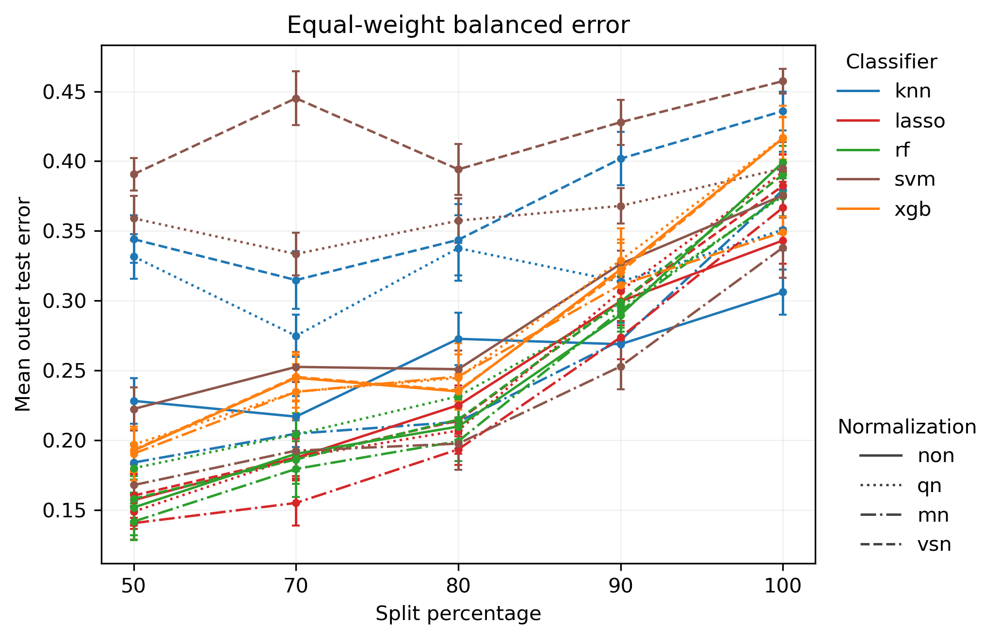
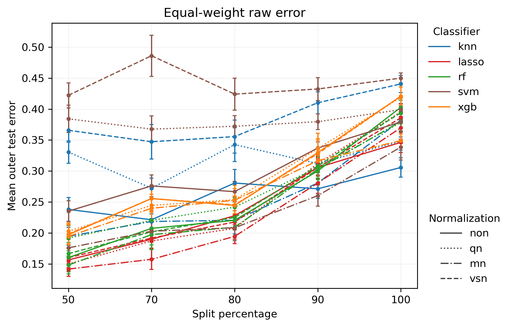
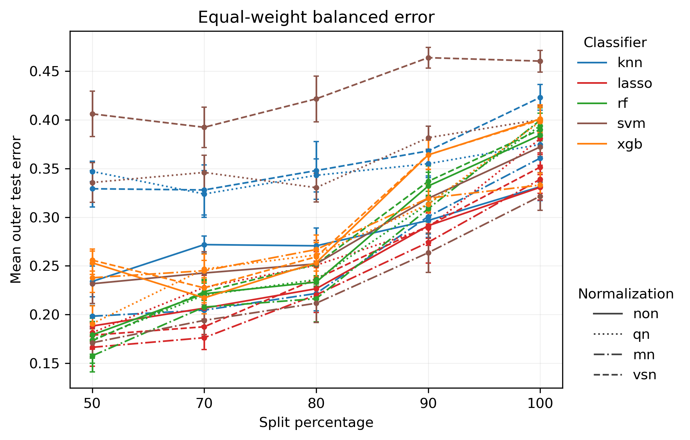
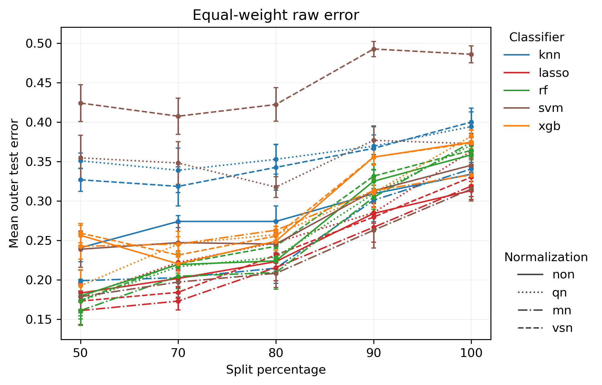

# Gou Pro — Dual-Track Validation Result Interpretation

## Research purpose

This Pro analysis separates the original single SSV evaluation into two complementary tracks:

- **Natural protocol = primary real-world analysis**: preserves the observed class prevalence in each batch and is intended to reflect the total difficulty of deployment across the original Gou discovery and validation cohorts.
- **Class-stratified protocol = sensitivity / mechanism analysis**: approximately matches class composition across batches so that the influence of class-prevalence differences is reduced, allowing the remaining degradation to be interpreted more directly as cross-cohort / cross-site distribution shift.

The purpose of this design is to separate different sources of distribution shift rather than mix them into one summary curve.

For Gou, this distinction is especially important because the original medical study is a **plasma cell-free RNA (cfRNA) lung-cancer detection** study. The original paper constructed a discovery cohort from `NOR_SZBA + LC_SZDE` and an independent validation cohort from `NOR_SZDW + LC_SZBU`. These batches were collected at different clinical centers, so cohort identity, collection site, and disease status are structurally entangled.

## Gou Pro results

### 1. Class-stratified protocol

*Figure 1. Gou — Class-stratified protocol: equal-weight balanced error.*

*Figure 2. Gou — Class-stratified protocol: equal-weight raw error.*

Under the class-stratified protocol, the class composition of the two cohort/batch sides is made more comparable. The remaining change in performance is therefore less attributable to simple differences in lung-cancer versus cancer-free prevalence.

For Gou, the result is pronounced: across most classifier–normalization combinations, both raw error and balanced error increase as the split becomes more batch-separated, with especially clear deterioration toward split 90–100. The degradation therefore does **not** disappear after controlling class prevalence.

This is the most important mechanistic finding in Gou Pro. It indicates that the performance loss cannot be explained by label-prevalence imbalance alone. Instead, the data are consistent with a substantial **within-class cross-cohort / cross-site distribution shift**: even after making the case/control composition more comparable, the feature distribution seen in one cohort does not transfer cleanly to the other.

In statistical terms, the result is more consistent with changes in

\[
P(X\mid Y,\text{cohort})
\]

than with a pure shift in

\[
P(Y).
\]

That distinction matters because a pure prevalence shift would be expected to weaken substantially after class stratification, whereas the Gou degradation remains strong.

### 2. Natural protocol

*Figure 3. Gou — Natural protocol: equal-weight balanced error.*

*Figure 4. Gou — Natural protocol: equal-weight raw error.*

The Natural protocol preserves the observed class prevalence of the original batches and therefore more closely represents the real deployment problem: a model developed in one clinical cohort is applied to patients collected in another cohort / center without artificially balancing the disease composition.

The same qualitative pattern appears again. Most methods show substantially higher error at split 100 than at split 50, and many curves rise sharply between approximately split 80 and split 90. This suggests that model performance becomes materially worse once the train and test populations are nearly separated by cohort.

The Natural track therefore captures the **total deployment difficulty**, including:

- cohort / site-specific feature shift;
- class-prevalence differences;
- other center-associated nuisance variation;
- possible differences in patient characteristics or pre-analytical conditions.

The fact that the Natural and Class-stratified tracks tell essentially the same story is important: prevalence differences may contribute, but they are not sufficient to explain the observed degradation.

### 3. Raw error vs balanced error

Across all four plots, the overall split-dependent trend is visible in both raw error and balanced error.

Raw error reflects the overall misclassification rate under the observed class distribution, while balanced error gives the two biological classes more equal influence. If the Gou degradation were mainly caused by one class becoming more common or easier to predict, the raw and balanced curves would be expected to diverge strongly.

Instead, both metrics generally worsen as batch separation increases. This provides another layer of evidence that the main phenomenon is not simply class imbalance. The robustness failure persists even when the evaluation metric reduces majority-class dominance.

### 4. The distinctive Gou finding

The particularly informative feature of Gou is that **all four views converge on the same qualitative conclusion**:

\[
\text{greater cohort separation}
\;\Longrightarrow\;
\text{higher test error}.
\]

This conclusion survives two orthogonal sensitivity checks:

1. **Natural vs Class-stratified prevalence**
2. **Raw vs Balanced error**

Therefore, the Gou result is stronger than a single SSV curve. It suggests that the observed deterioration is a robust property of cross-cohort generalization rather than an artifact of one prevalence assumption or one error metric.

A second notable feature is the apparently nonlinear deterioration around the high-separation regime, especially from approximately split 80 to split 90. This can be described conservatively as a **threshold-like robustness breakdown**: once enough cohort overlap is removed, many models lose performance rapidly. This should not yet be interpreted as a formal changepoint without additional statistical testing, but it is an important empirical pattern.

## Medical interpretation

The original Gou study is a **liquid-biopsy early lung-cancer detection** setting based on plasma cfRNA profiles measured using SLiPiR-seq.

Clinically, the desired use case is not merely:

> Can a model distinguish lung-cancer patients from cancer-free individuals after a random train/test split within the same retrospective dataset?

The more relevant question is:

> Can a cfRNA-based lung-cancer classifier trained in one clinical cohort retain its performance when applied to patients recruited at another clinical center?

This distinction is critical because the original study used:

- `LC_SZDE` and `NOR_SZBA` as the **discovery cohort**;
- `LC_SZBU` and `NOR_SZDW` as the **independent validation cohort**.

These groups came from different clinical centers. Therefore, a random split within the discovery cohort can preserve many cohort-specific characteristics in both train and test sets, whereas a strict cohort-separated validation more closely approximates deployment to a new hospital or patient population.

The Gou Pro result therefore represents a realistic clinical generalization problem:

\[
\boxed{
\text{cfRNA lung-cancer detection across independent clinical centers}
}
\]

rather than only an abstract batch-effect problem.

Importantly, this result does **not** imply that the cfRNA cancer signal is absent. The original paper reported extensive differentially expressed cfRNAs between lung-cancer cases and cancer-free controls and demonstrated that early-stage lung cancer can produce detectable plasma cfRNA changes. The Pro result instead shows that part of the apparent predictive performance under easier validation settings may depend on cohort-associated structure that does not transfer perfectly to an independent center.

## Relation to the original Gou study

The Gou paper itself provides a clinically meaningful counterpart to the Pro result.

The original workflow randomly split the discovery cohort into 80% training and 20% test sets and repeated this process many times. Performance within that discovery framework was high. The study then evaluated an independent validation cohort collected from different centers.

That original design creates two validation regimes:

\[
\text{within-discovery random validation}
\]

and

\[
\text{independent-cohort validation}.
\]

The Gou Pro SSV analysis converts that discrete comparison into a continuous stress test:

\[
50 \rightarrow 70 \rightarrow 80 \rightarrow 90 \rightarrow 100.
\]

Instead of asking only whether performance differs between a random split and one independent validation cohort, the Pro analysis asks how prediction error changes as train/test cohort separation is progressively increased.

The resulting curves show a broad and systematic rise in error. This provides a direct visualization of the **generalization gap between IID-like validation and independent clinical-cohort validation**.

The original paper also explicitly noted that cases and controls were collected from different sites and that age and sex were not rigorously matched, meaning that observed transcriptomic differences could be influenced by confounding factors. This makes Gou a particularly important SSV example: the dataset contains a clinically realistic but structurally difficult setting in which disease signal and collection-site information are partially intertwined.

## Overall interpretation

The Natural and Class-stratified analyses lead to the same qualitative conclusion for Gou: stronger separation between the original discovery and independent-validation cohorts is associated with worse predictive performance.

The central result is not merely that split 100 is harder than split 50. The more informative finding is that this degradation remains visible when:

- class prevalence is approximately controlled;
- balanced error is used instead of raw error.

Therefore, the result is not well explained by a simple label-prevalence shift.

The remaining degradation is more consistent with a **cross-site / cross-cohort distribution shift within biological classes**. In practical terms, a lung-cancer patient recruited at one hospital may not have exactly the same cfRNA feature distribution as a lung-cancer patient recruited at another hospital, and the same may be true for cancer-free controls.

The result should still be interpreted cautiously. Because disease status and recruitment center are structurally confounded in the original data, the analysis cannot uniquely decompose the observed shift into:

- true biological heterogeneity;
- hospital / site effects;
- patient demographic differences;
- pre-analytical variation;
- other cohort-specific factors.

Therefore, the appropriate conclusion is:

> **The Gou degradation is consistent with cohort/site-associated distribution shift and cannot be attributed solely to class-prevalence imbalance.**

It would be too strong to claim that a pure technical batch effect has been causally isolated.

## Concise conclusion

For Gou Pro, most classifier–normalization combinations show substantially higher error as the split moves from 50 toward 100 under both Natural and Class-stratified protocols. The same qualitative pattern is present in both raw and balanced error.

Because the degradation remains strong after class-prevalence balancing, the result cannot be explained by prevalence imbalance alone. Instead, it is consistent with substantial within-class cross-cohort / cross-site distribution shift.

In the underlying medical setting, this corresponds to a realistic liquid-biopsy deployment problem: a plasma cfRNA lung-cancer classifier developed in one clinical cohort must generalize to patients recruited at an independent clinical center. The Pro result shows that random or partially mixed validation can provide substantially more optimistic performance than strict cohort-separated validation.

The most important Gou-specific message is therefore:

\[
\boxed{
\text{high within-cohort performance does not guarantee robust cross-center clinical generalization}
}
\]

and the dual-track analysis makes clear that this gap is not merely a consequence of different cancer/control prevalence across cohorts.
